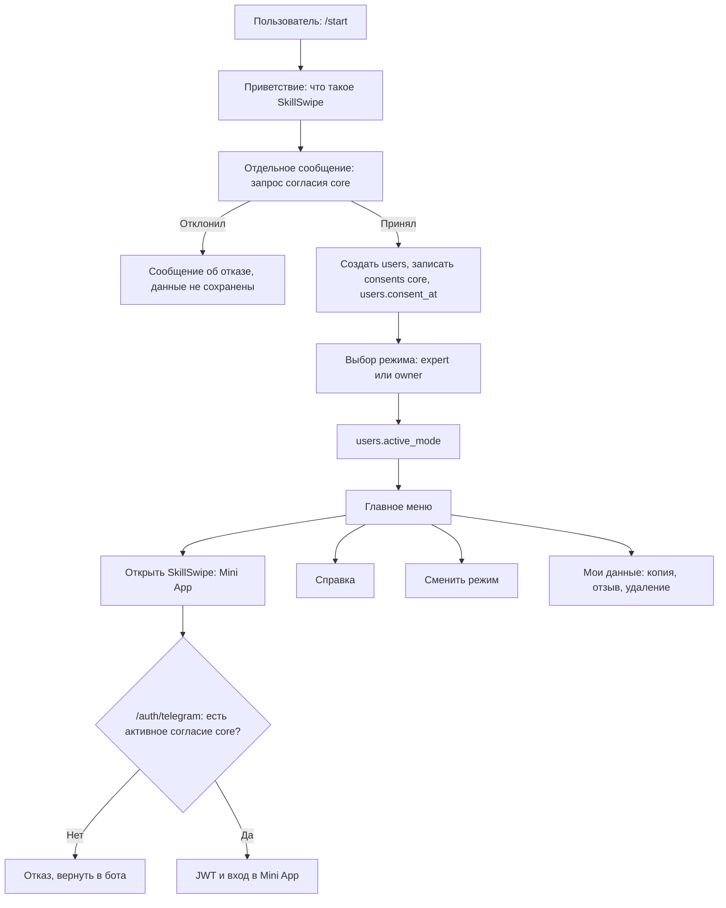

# Персональные данные в SkillSwipe: анализ и план проработки

| | |
| --- | --- |
| **Статус** | Решения D1–D7 (раздел 2) приняты 23.11.2026 (SSK-15). Юридическое заключение (раздел 4.5) смоделировано аналитиком: до публичного запуска заменить фактическим заключением |
| **Дата** | 23.11.2026 |
| **Связанные документы** | [`total.md`](total.md) (требования, ER, API), SSK-9 (Mini App) |
| **Владелец** | Аналитик |

> Документ не является юридической консультацией. Нормы 152-ФЗ изменялись в 2025 и 2026 годах, поэтому номера статей, сроки и перечни нужно сверить по официальному тексту (КонсультантПлюс, Гарант, pravo.gov.ru) до выхода к реальным пользователям. Места, требующие проверки, помечены **(проверить)**.

## 1. Цель и область

Определить, какие персональные данные (ПД) обрабатывает SkillSwipe, на каком основании, как их хранить в БД, как получать согласие и что менять в требованиях, API и модели данных. Отдельно описан целевой процесс онбординга в боте и тексты сообщений.

**Входит:** онбординг в боте (`/start`, согласие, режим, меню), согласия и их хранение, права пользователя (отзыв, экспорт, удаление), передача данных в LLM, безопасность хранения, документы (политика, согласие).

**Не входит:** интерфейс Mini App (SSK-9), юридическое оформление оператора как организации.

## 2. Принятые решения

Решения приняты 23.11.2026 по задаче SSK-15 (issue #23) на основе рекомендаций аналитика и юридического заключения (раздел 4.5). Решения D3, D4 и D7 остаются **предварительными**: их нужно подтвердить проверкой цен и договора, качества извлечения навыков и значений сроков.

| № | Решение | Принято | Статус |
| --- | --- | --- | --- |
| D1 | Юрисдикция | РФ, 152-ФЗ. GDPR пока не целевой режим | Принято |
| D2 | Оператор ПД | Физическое лицо из команды как самозанятый или ИП (реквизиты `[оператор]`). Публичный запуск после выполнения условий из D2 | Принято |
| D3 | Хостинг | БД и файлы в РФ. Предварительно Yandex Cloud, альтернатива Selectel | Принято (предварительно) |
| D4 | LLM для ML-1 | ML-1 с резюме вне критического пути MVP, опциональная функция. Целевой вариант: российский LLM плюс псевдонимизация. OpenRouter не используется | Принято (предварительно) |
| D5 | Возраст | 18+, самодекларация в согласии | Принято |
| D6 | Сообщения удалившегося пользователя | Текст заменяется на «[удалено]», автор обнуляется | Принято |
| D7 | Срок хранения резюме | Файл до 30 дней, `extracted_text` и `extracted_data` до 7 дней, подтверждённые навыки остаются | Принято (предварительно) |

Дата принятия: 23.11.2026. Ответственный: аналитик.

### D1. Юрисдикция

**Решение:** пользователи в РФ, применяется 152-ФЗ. GDPR не является целевым режимом.

**Обоснование:** язык, аудитория и тексты проекта российские. Пересмотреть решение, если сервис начнут ориентировать на пользователей из ЕС (языки интерфейса, маркетинг, платежи в евро) или если юрист сочтёт, что GDPR применим.

### D2. Оператор ПД

**Решение:** оператором выступает **физическое лицо из команды, зарегистрированное как самозанятый или ИП**. ФИО или наименование и контакты вносит команда вместо плейсхолдера `[оператор]`. Если организация (вуз, курс, заказчик) согласится стать оператором, она заменяет это решение, остальные пункты не меняются.

**Основание (раздел 4.5, вопрос 1):** оператором может быть любое юридическое или физическое лицо, статус самозанятого не освобождает от обязанностей оператора. Оператор указывается в согласии и политике, отвечает за обработку и подаёт уведомление в Роскомнадзор (ст. 22) до начала обработки.

**Рассмотренные варианты:**

| Вариант | Плюсы | Минусы | Вывод |
| --- | --- | --- | --- |
| Участник команды как физлицо без статуса | Не нужно оформление | Личная ответственность, личные контакты в публичных документах | Не выбран |
| Самозанятый или ИП из команды | Отдельный статус, деловые контакты, быстрое оформление | Остаётся личная ответственность | **Выбран** |
| Организация (вуз, курс, заказчик) | Организационная ответственность | Долгое согласование, нужны юристы организации | Подходит при согласии организации |

**Условия публичного запуска.** До их выполнения допускаются только закрытое тестирование и синтетические данные:
1. Оператор назван, реквизиты внесены в согласие, политику и сообщения бота.
2. Подано уведомление об обработке (ст. 22).
3. Принято решение по чату: уведомление как организатор распространения информации или прямой диалог (раздел 4.5, вопрос 2).
4. Опубликованы политика и условия обработки данных, разрешённых для распространения (раздел 4.5, вопрос 3).

### D3. Хостинг в РФ

**Решение:** БД и файловое хранилище размещаются на серверах в РФ (ч. 5 ст. 18 152-ФЗ).

**Предварительный выбор:** Yandex Cloud. Для MVP достаточно виртуальной машины с Docker Compose (как сейчас) и Object Storage для файлов резюме. При переходе на управляемую БД использовать Managed Service for PostgreSQL с расширением `vector`.

**Альтернатива:** Selectel (управляемый сервис PGVector, объявлен в сентябре 2026).

**Обоснование:**
- В `docker-compose.yml` сейчас стоит обычный `postgres:17` без `pgvector`, а эмбеддинги нужны для ML-2. Для стендов нужен образ с расширением (например, `pgvector/pgvector:pg17`) или управляемая БД с ним.
- Yandex Cloud документирует расширение `vector` для управляемого PostgreSQL ([документация](https://yandex.cloud/ru/docs/managed-postgresql/operations/extensions/vector)), а у Selectel появился [управляемый PGVector](https://www.cnews.ru/news/line/2026-09-28_selectel_predstavil_upravlyaemyj).
- У Yandex Cloud есть и российские LLM (Yandex AI Studio), что упрощает вариант A из D4: один провайдер для БД, файлов и модели.

**Условия до оформления (проверить):** цена и наличие грантов для учебных проектов, регион размещения данных, договор и сведения о размещении, шифрование и бэкапы, доступность Object Storage с приватным доступом.

### D4. Вариант LLM для ML-1

**Решение:**
1. Ручной выбор навыков остаётся основным путём (Must). Автоизвлечение из резюме (ML-1) становится опциональной функцией (Should).
2. Целевой вариант для ML-1: **A**, российский LLM-провайдер (например, Yandex AI Studio или GigaChat; доступность моделей и условия проверить) вместе со слоем псевдонимизации **B**.
3. Вариант **C** (OpenRouter как есть) не используется, пока не выполнены условия: уведомление по ст. 12, сведения о получателях и странах, согласие `llm_processing`.

**Обоснование:** при российском провайдере и хостинге в РФ отдельная трансграничная передача для ML-1 не планируется, а значит снимается самая тяжёлая часть регуляторики. Это меняет текущее описание стека в `total.md`, где основным указан OpenRouter.

**Условия подтверждения:** ML-инженеры проверяют качество извлечения на 30 размеченных примерах после маскирования (NFR-07: precision и recall не ниже порога, значение TBD) и оценивают стоимость и лимиты выбранной модели. Если качество недостаточно, вернуться к решению и рассмотреть вариант C с выполнением всех условий.

### D5. Возраст

**Решение:** сервис для лиц 18+. Возраст подтверждается самодекларацией в тексте согласия. Документальная проверка возраста не выполняется.

### D6. Сообщения удалившегося пользователя

**Решение:** при удалении аккаунта текст сообщений заменяется на «[удалено]», ссылка на автора обнуляется. Время сообщения и принадлежность к мэтчу сохраняются, чтобы не ломать чат собеседника.

**Обоснование:** текст может содержать ПД удалившегося пользователя. Альтернатива (оставить как есть) не соответствует требованию об уничтожении данных после отзыва согласия. Решение действует, пока сохраняется ретрансляция сообщений: если команда выберет статус организатора распространения информации, нужно проверить, не конфликтует ли обязанность хранения с удалением текста (раздел 4.5, вопрос 2).

### D7. Сроки хранения резюме

**Решение:**
- файл резюме в хранилище удаляется после подтверждения пользователем навыков, но не позднее 30 дней после загрузки;
- `resumes.extracted_text` и `resumes.extracted_data` (JSONB) очищаются после подтверждения навыков, но не позднее 7 дней после извлечения;
- `resumes.original_filename` удаляется вместе с файлом;
- подтверждённые навыки остаются в `user_skills`.

**Обоснование:** минимизация данных. Значения 30 и 7 дней предложены аналитиком и подтверждаются командой. Способ реализации (удаление строки `resumes` или обнуление полей) определяет backend; в таблице `s3_key` и `original_filename` сейчас обязательные поля.

### Последствия решений для других задач

| Задача | Что меняется |
| --- | --- |
| Реестр ПД | Использовать сроки из D7 и фактические имена полей `resumes` |
| Политика, согласие, тексты бота | Реквизиты оператора из D2 (`[оператор]`). Отдельное согласие на публикацию профиля по ст. 10.1 (раздел 8.10). Согласие на ИИ запрашивается при загрузке резюме |
| Требования в `total.md` | Описание стека ML-1 (вместо OpenRouter российский провайдер), NFR-06, NFR-21 |
| ML | Оценить российских LLM-провайдеров на 30 размеченных примерах, подготовить псевдонимизацию |
| Безопасность и инфраструктура | Выбрать провайдера (D3), заменить образ БД на образ с `pgvector`, настроить шифрование и бэкапы |
| Регуляторика | Уведомление по ст. 12 не планируется (российский LLM и хостинг в РФ). Уведомление об обработке (ст. 22) подаётся оператором до публичного запуска. По чату решение между статусом ОРИ и прямым диалогом (раздел 4.5) |
| Модель данных | В `consents` добавить `scope`, `subject_hash`, `user_id` допускает NULL (раздел 6.1). Таблица заблокированных хэшей |
| Чат (FR по чату) | До публичного запуска выбрать ретрансляцию с уведомлением ОРИ или прямой диалог после мэтча |

## 3. Инвентаризация данных

| Данные | Таблица | Категория и риск | Цель | Срок хранения (предложение) |
| --- | --- | --- | --- | --- |
| Telegram ID, username, имя, язык | `users` | Идентификатор | Аккаунт, вход | Пока аккаунт активен |
| Согласия | `consents` (новая) | Доказательство законности обработки | Подтверждение согласия | Пока есть аккаунт, далее обезличенная запись на 3 года (раздел 4.5, вопрос 5) |
| Профиль: о себе, опыт, часы в неделю, формат | `expert_profile` | Показывается другим пользователям | Подбор | Пока аккаунт активен |
| Резюме (файл и `parsed_text`) | `resume` | **Высокий:** телефон, email, места работы, часто возраст и фото | Извлечение навыков | До подтверждения навыков или N дней |
| Навыки | `expert_skill`, `project_skill` | Низкий | Подбор | Пока аккаунт активен |
| Проекты | `project` | Данные пользователя, видны другим | Подбор | Пока аккаунт активен |
| Свайпы, мэтчи, оценки | `swipe`, `match`, `recommendation_score` | Профилирование поведения | Ранжирование, мэтчи | Пока аккаунт активен |
| Сообщения чата | `message` | Тайна переписки, ПД собеседника | Общение | Пока есть мэтч и аккаунт, решение D6 |
| Эмбеддинги | `embedding` | Производные от ПД, считаются ПД | Ранжирование | Каскадно с владельцем |
| Жалобы | `report` | ПД третьих лиц | Модерация | Ограниченный срок после разбора |
| События | `event_log` | Не должны содержать тексты ПД | Продуктовые метрики | Ограниченный срок |
| Вызовы LLM | `llm_call` | Только хэш входа и метрики | Лимиты, воспроизводимость | Ограниченный срок |
| Состояние ботов | `bot_start` | Служебные | Доставка сообщений | Пока аккаунт активен |
| Скрытие пользователей | `user_block` | Служебные | Приватность | Пока аккаунт активен |

**Не собираем:** телефон, email, паспортные данные, дату рождения, фото, геолокацию. Username опционален (US-22).

**Специальные категории** (здоровье, политические и религиозные взгляды и т. п., ст. 10 152-ФЗ) не собираются. Резюме может их содержать: нужно предупреждение при загрузке и фильтрация при разборе.

## 4. Правовая карта

### 4.1. 152-ФЗ «О персональных данных»

| Тема | Требование | Что делаем |
| --- | --- | --- |
| Согласие (ст. 9) | С 1 сентября 2025 согласие оформляется отдельно от других документов и информации, которые подтверждает человек ([156-ФЗ от 24.06.2025](https://www.garant.ru/news/1850806/)). Согласие должно быть конкретным, предметным, информированным, сознательным и однозначным ([Контур](https://kontur.ru/articles/1577)). Штрафы за нарушение порядка согласия доходят до 700 тыс. руб. ([Гарант](https://www.garant.ru/article/1862510/)) | Отдельное сообщение только про согласие, без склейки с правилами и политикой. Отдельные согласия на отдельные цели (раздел 8) |
| Форма согласия | Допускается любая форма, позволяющая подтвердить факт получения ([buh.ru](https://buh.ru/articles/novyy-poryadok-oformleniya-soglasiy-na-obrabotku-personalnykh-dannykh-s-1-sentyabrya-2025-goda.html)) | Кнопка в боте плюс журнал `consents`. Обязательные элементы содержания и состав журнала: раздел 4.5, вопрос 4 |
| Политика (ст. 18.1) | Публичная политика обработки ПД | Страница вне бота, ссылка в боте, регистрация в BotFather |
| Специальные категории (ст. 10) | Обработка ограничена | Не собираем, предупреждаем в форме загрузки резюме |
| Распространение (ст. 10.1) | Для ПД, разрешённых для распространения неопределённому кругу, нужно отдельное согласие | По заключению юриста показ профиля в ленте оформляется как согласие на распространение (раздел 4.5, вопрос 3). Требования к содержанию: [приказ Роскомнадзора от 24.02.2021 № 18](https://www.klerk.ru/doc/558708/) |
| Трансграничная передача (ст. 12) | С 1 марта 2023 уведомление Роскомнадзора о передаче в любую страну ([Клерк](https://www.klerk.ru/blogs/moedelo/567870)). Начинать передачу можно после 10 рабочих дней на рассмотрение ([pravo.ru](https://pravo.ru/opinion/266312/)) | Если ML-1 использует зарубежный LLM, подаём уведомление до начала передачи, получаем сведения от получателя. По данным [Состава](https://www.sostav.ru/blogs/293571/113022), Федеральный закон от 26.07.2026 № 265-ФЗ изменил определение «адекватных» стран, проект нового перечня Роскомнадзора на конец сентября 2026 подписан не был **(проверить актуальный статус)** |
| Локализация (ч. 5 ст. 18) | Первичная запись, хранение и накопление ПД граждан РФ на серверах в РФ ([Клерк](https://www.klerk.ru/user/2548465/716829/)) | БД и файловое хранилище в РФ |
| Уведомление об обработке (ст. 22) | Подают [все операторы](https://habr.com/ru/post/914414), включая ИП и самозанятых | Подать до выхода к реальным пользователям |
| Права субъекта (ст. 14, 21) | Ответ на запрос о данных в течение [10 рабочих дней](https://www.klerk.ru/blogs/fedresurs/679821). При отзыве согласия прекращение обработки и уничтожение данных (по моим данным, 30 дней, совпадает с NFR-06) | Эндпоинты отзыва, экспорта и удаления, регламент ответов на запросы **(проверить срок ст. 21)** |
| Утечки | Уведомление Роскомнадзора об инциденте в короткие сроки (по моим данным, 24 часа и 72 часа) | План реагирования на инциденты **(проверить сроки)** |
| Организатор распространения информации (ст. 10.1 149-ФЗ) | К организаторам относятся в том числе мессенджеры. Обязанности: [уведомить Роскомнадзор о начале деятельности, хранить определённые данные, содействовать органам безопасности](https://www.advgazeta.ru/ag-expert/advices/arkhivnuyu-obyazannost-vladeltsev-saytov-i-prilozheniy-obnovili/). За неуведомление штраф до 300 тыс. руб., за повторное до 1 млн руб. | Решение по чату до публичного запуска (раздел 4.5, вопрос 2) |

### 4.2. Правила Telegram Bot Platform

По [Bot Developer Terms](https://telegram.org/tos/bot-developers?setln=en):

- Нужна политика конфиденциальности, [доступная пользователям](https://telegram.org/tos/bot-developers?setln=es); её регистрируют в BotFather, у Mini App в настройках появится кнопка Privacy Policy.
- Данные, присланные пользователем, можно использовать при [информировании и индивидуальном, явном, активном и отзываемом согласии](https://telegram.org/tos/bot-developers?setln=ar).
- Запрещено собирать и хранить данные сверх необходимого.
- Минимум по безопасности: [шифрование данных at rest с хранением ключа отдельно, оповещение пользователей об утечках](https://telegram.org/tos/bot-developers?setln=nl).
- Данные удаляются по запросу пользователя.
- Нарушения ведут к отключению бота.

### 4.3. GDPR (если будут пользователи из ЕС)

- Правовое основание (ст. 6), условия согласия (ст. 7), информирование (ст. 13), права субъекта (ст. 15–22).
- Договор с обработчиком, в том числе с LLM-провайдером (ст. 28), передача в третьи страны (ст. 44 и далее).
- Privacy by design (ст. 25), реестр обработки (ст. 30), безопасность (ст. 32).
- Уведомление об утечке за 72 часа (ст. 33), оценка воздействия DPIA для профилирования (ст. 35).
- Возраст согласия зависит от страны (для Австрии 14 лет).

### 4.4. Вопросы для юриста

1. Кто может быть оператором ПД (организация, ИП или самозанятый, физлицо).
2. Бот-ретранслятор между пользователями (чат) может подпадать под правила о сервисах обмена мгновенными сообщениями (149-ФЗ).
3. Нужно ли оформлять показ профиля в ленте как согласие на распространение (ст. 10.1).
4. Какие реквизиты ч. 4 ст. 9 требуются при согласии кнопкой.
5. Срок и основание хранения журнала согласий и хэша `telegram_id` для блокировок после удаления аккаунта.
6. Дайджест (US-19): нужно ли отдельное согласие по 38-ФЗ, если в нём появится реклама.

### 4.5. Заключение юриста по вопросам 4.4

> **Смоделировано аналитиком.** Ответы сформулированы как ожидаемое заключение квалифицированного юриста на основе открытых источников и нужны, чтобы довести процесс до конца. До публичного запуска заменить фактическим заключением (ФИО, дата) или подтвердить. Формулировки на уровне статей сверить по действующим текстам.

**Вопрос 1. Оператор.**
Оператором может быть любое юридическое или физическое лицо, определяющее цели и способы обработки. Статус самозанятого от обязанностей оператора не освобождает. Оператор указывается в согласии и политике, подаёт уведомление в Роскомнадзор (ст. 22) до начала обработки (его [должны подавать все операторы](https://habr.com/ru/post/914414), включая ИП и самозанятых).
*Решение:* оператор: самозанятый или ИП из команды, при согласии организации вместо него организация (D2).

**Вопрос 2. Чат через бота.**
Ретрансляция сообщений между пользователями по функции близка к сервису обмена сообщениями. Мессенджеры относятся к организаторам распространения информации (ст. 10.1 149-ФЗ), у которых [три базовые обязанности](https://www.advgazeta.ru/ag-expert/advices/arkhivnuyu-obyazannost-vladeltsev-saytov-i-prilozheniy-obnovili/): уведомить Роскомнадзор о начале деятельности, хранить определённые данные и сотрудничать с органами безопасности. Штраф за неуведомление до 300 тыс. руб., за повторное до 1 млн руб. Объём и срок хранения (в источниках встречается срок в три года вместо одного после изменений закона) нужно проверить по действующему тексту.
Варианты:
- (а) оставить ретрансляцию, подать уведомление как организатор и обеспечить хранение. Хранение может конфликтовать с удалением текста сообщений (D6).
- (б) для снижения риска перейти на прямой диалог в Telegram после взаимного мэтча с согласия обеих сторон (без ретрансляции и хранения текста).

*Решение:* для закрытого тестирования ретрансляция сохраняется. Выбор между (а) и (б) обязателен до публичного запуска (условие 3 из D2). Отдельно отслеживать ограничения на использование иностранных мессенджеров (41-ФЗ): по вторичному источнику они [распространяются на перечисленные категории организаций](https://mosdigitals.ru/blog/zapret-na-ispolzovanie-inostrannyh-messendzherov-aktualnye-ogranicheniya-2026-goda-i-otvetstvennost-biznesa); применимость к SkillSwipe не подтверждена.

**Вопрос 3. Профиль в ленте.**
Распространение — это действия, направленные на раскрытие данных неопределённому кругу лиц (п. 5 ст. 3 152-ФЗ). Профиль виден любому, кто принял согласие в боте, поэтому его нужно считать распространением. Нужно отдельное согласие по ст. 10.1: молчание не считается согласием, письменная форма не обязательна, требования к содержанию установлены [приказом Роскомнадзора от 24.02.2021 № 18](https://www.klerk.ru/doc/558708/). Субъект вправе установить условия и запреты на обработку, а оператор обязан [опубликовать информацию об условиях и запретах не позднее 3 рабочих дней](https://www.fbk.ru/upload/iblock/0f5/Полякова_Обработка%20ПДн_изменения%20в%20зак-ве__28.07.2022.pdf) с момента получения согласия.
*Решение:* согласие `profile_publication` оформляется отдельным экраном (раздел 8.10) с перечнем категорий (о себе, опыт, навыки, доступность), без фамилии, username и контактов; условие: показ только внутри SkillSwipe, запрет копирования и передачи третьим лицам. Состав выбора хранится в `consents.scope`. Условия публикуются на странице документов в течение 3 рабочих дней после получения согласия.

**Вопрос 4. Реквизиты согласия кнопкой.**
Форма согласия может быть любой, позволяющей подтвердить факт получения. Согласие должно быть [конкретным, предметным, информированным, сознательным и однозначным](https://kontur.ru/articles/1577). ФИО и паспортные данные не нужны, так как оператор их не собирает, а пользователь идентифицируется по Telegram ID. Обязательные элементы текста: оператор и контакты, цели, перечень данных, действия и способы обработки, получатели и лица, обрабатывающие данные по поручению (хостинг, при включении ИИ также LLM-провайдер), срок, порядок отзыва. Подтверждение получения согласия лежит на операторе (ч. 3 ст. 9).
*Решение:* в журнале хранятся версия и хэш текста, время, `user_id`, `message_id` сообщения с кнопкой, язык. Состав элементов текста закреплён в разделах 8.2 и 8.11. Список элементов сверить с ч. 4 ст. 9 в действующей редакции.

**Вопрос 5. Журнал согласий и хэш `telegram_id`.**
Так как доказывать получение согласия должен оператор, после удаления аккаунта запись журнала хранится в обезличенном виде: `user_id` обнуляется, добавляется посоленный хэш, остаются тип, версия документа, время выдачи и отзыва. Срок: 3 года (общий срок исковой давности, ст. 196 ГК РФ), затем удаление. Хэш `telegram_id` для блокировок хранится на основании законного интереса защиты других пользователей. Срок: 12 месяцев, отражается в политике. Такой хэш остаётся персональными данными (это псевдонимизация, а не обезличивание).
*Решение:* `consents` не удаляется каскадом, а обезличивается (раздел 6.1). Блокировки хранятся в отдельной таблице с полем срока.

**Вопрос 6. Дайджест.**
Дайджест подборок профилей и проектов внутри сервиса является сервисным информированием, а не рекламой. Реклама по сетям электросвязи требует предварительного согласия адресата (ч. 1 ст. 18 38-ФЗ), и [доказывать его должен рекламораспространитель](https://www.klerk.ru/user/2651996/718408/).
*Решение:* дайджест без рекламы, включается отдельным согласием `digest`. Рекламные материалы допускаются только после отдельного согласия.

**Дополнительно.**
- Уведомление по ст. 12 не планируется: ML-1 использует российский LLM, БД и файлы размещены в РФ. Взаимодействие через Telegram как канал связи указывается в политике, остаточный риск отслеживается.
- Уведомление об обработке (ст. 22) подаётся до публичного запуска.

## 5. Целевой процесс онбординга



Что меняем относительно исходного видения:

1. **`users` создаётся только после согласия.** До этого состояние диалога хранится в FSM (память или Redis с TTL). Тогда фраза в сообщении об отказе «мы ничего не сохранили» остаётся верной.
2. **Одного `users.consent_at` недостаточно.** Нужен журнал согласий с версией документа (раздел 6.1). Поле `users.consent_at` остаётся как кэш основного согласия.
3. **Согласие в отдельном сообщении**, без других документов и без галочек по умолчанию (требование ст. 9).
4. **Consent gate на backend.** Проверка в боте недостаточна: `/auth/telegram` не выдаёт JWT без активного согласия `core`.
5. **Ссылка на политику** в боте, в меню и в BotFather. Режим (`active_mode`) не относится к специальным категориям.
6. **Дополнительные согласия запрашиваются в момент использования функции:** публикация профиля при сохранении профиля, ИИ при загрузке резюме, дайджест при его включении, username при включении US-22.
7. **Язык.** Тексты согласия и меню хранятся во внешних словарях (NFR-17) и версионируются.

## 6. Хранение в БД

### 6.1. Таблица согласий

```sql
CREATE TABLE consents (
    id                BIGSERIAL PRIMARY KEY,
    user_id           BIGINT       REFERENCES users(id) ON DELETE SET NULL,  -- обнуляется при удалении аккаунта
    consent_type      VARCHAR(32)  NOT NULL,   -- core | llm_processing | profile_publication | digest | username_visibility
    document_version  VARCHAR(32)  NOT NULL,   -- версия текста согласия
    document_hash     CHAR(64)     NOT NULL,   -- SHA-256 текста, который видел пользователь
    language          VARCHAR(8)   NOT NULL,
    source            VARCHAR(16)  NOT NULL,   -- bot | miniapp
    scope             JSONB,                   -- для profile_publication: категории, условия и запреты
    subject_hash      CHAR(64),                -- посоленный хэш, заполняется при удалении аккаунта
    granted_at        TIMESTAMPTZ  NOT NULL DEFAULT now(),
    revoked_at        TIMESTAMPTZ
);

-- Не более одного активного согласия каждого типа на пользователя
CREATE UNIQUE INDEX uq_consents_active
    ON consents (user_id, consent_type)
    WHERE revoked_at IS NULL;
```

При удалении аккаунта запись `consents` не удаляется, а обезличивается: `user_id` обнуляется, заполняется `subject_hash`, запись хранится 3 года (раздел 4.5, вопрос 5), затем удаляется. Файл миграции Liquibase оформляется как `migrations/changelogs/ssk-XX.xml` и подключается в `master.yaml`.

### 6.2. Правила хранения

1. **Минимизация.** Таблицы и поля только под перечисленные цели, без «на всякий случай».
2. **Резюме.** Файл лежит в приватном объектном хранилище в РФ, в БД только путь. `parsed_text` удаляется после подтверждения навыков или по TTL (D7).
3. **Шифрование.** Шифрование диска или СУБД и дополнительно шифрование полей `resume.parsed_text` и `message.text` на уровне приложения. Ключи хранятся вне БД, переменные окружения, секреты не в репозитории.
4. **Эмбеддинги.** У `Embedding.owner_id` нет внешнего ключа, поэтому каскад не сработает автоматически. Нужны явное удаление в сервисе удаления аккаунта и тест на него.
5. **Лента.** До мэтча показываем только профессиональные поля. Фамилия, username и контакты не показываются.
6. **Сообщения при удалении аккаунта.** Текст сообщений удалившегося пользователя заменяется на «[удалено]», ссылка на пользователя обнуляется (D6).
7. **Блокировки.** Чтобы заблокированный пользователь не вернулся после удаления, в отдельной таблице хранится посоленный хэш `telegram_id` на 12 месяцев (законный интерес, указывается в политике; раздел 4.5, вопрос 5).
8. **Логи.** В `event_log.payload`, stdout, Sentry и других логах нет текстов профилей, резюме и сообщений. В `llm_call` только `input_hash`, модель, токены, стоимость, статус.
9. **Бэкапы.** Срок ротации не превышает срок удаления данных (30 дней).
10. **Доступ.** Роли БД по принципу минимальных прав, на dev и в тестах только синтетика, на демонстрациях без реальных профилей.
11. **Удаление.** Срок по NFR-06 (30 дней). Ответ на запрос пользователя о его данных не позднее 10 рабочих дней.

### 6.3. Новые и изменяемые эндпоинты

| Метод | Путь | Описание |
| --- | --- | --- |
| POST | `/consents` | Записать согласие (тип, версия документа) |
| POST | `/consents/{type}/revoke` | Отозвать согласие. Для `core` равно запросу на удаление аккаунта |
| GET | `/users/me/consents` | Список согласий пользователя |
| GET | `/users/me/data-export` | Выгрузка данных пользователя |
| DELETE | `/users/me` | Уже есть. Доработать: явное удаление `embedding`, обезличивание `message` |
| POST | `/auth/telegram` | Доработать: отказ без активного согласия `core` |

Команды бота: `/privacy`, раздел меню «Мои данные».

## 7. LLM и трансграничная передача

Вызов OpenRouter с текстом резюме или профиля может считаться трансграничной передачей ПД. Кроме того, OpenRouter перенаправляет запрос провайдерам моделей, поэтому получателей и стран может быть несколько. Варианты:

| Вариант | Плюсы | Минусы |
| --- | --- | --- |
| A. Российский LLM для ML-1 (YandexGPT, GigaChat) | Нет трансграничной передачи | Нужно проверить качество на размеченной выборке, возможны платные тарифы |
| B. Псевдонимизация перед отправкой | Меньше риска и данных у получателя | Резюме полностью не обезличить, остаётся остаточный риск, нужна реализация и тесты |
| C. OpenRouter как есть | Быстрее всего | Уведомление в РКН по ст. 12, получение сведений от иностранных получателей, согласие на ИИ, самый тяжёлый вариант |

**Рекомендация:**

1. ML-1 с резюме и тексты профиля через LLM делаем **опциональной функцией**. MVP работает на ручном выборе навыков.
2. Согласие `llm_processing` запрашивается в момент загрузки резюме, а не при `/start`.
3. Перед отправкой в LLM скрываются: телефоны, email, ссылки (LinkedIn, GitHub, `@username`), ФИО, адреса, даты рождения.
4. Если остаётся зарубежный LLM, до начала передачи подаётся уведомление по ст. 12 (вариант C).

Это меняет NFR-06: сейчас там сказано, что согласие на передачу текста во внешний LLM берётся при `/start`.

**Принято по SSK-15 (предварительно):** целевой вариант A плюс B, вариант C не используется. Подробности и условия в разделе 2 (D4).

## 8. Тексты бота (черновики)

Плейсхолдеры в `[скобках]` заполняются после решений из раздела 2. Лимит одного сообщения Telegram 4096 символов, полный текст согласия и политика публикуются на странице вне бота.

### 8.1. Ответ на /start

> 👋 Привет! Это **SkillSwipe**: сервис, где эксперты находят стартап-проекты, а основатели находят экспертов под нужные навыки.
> Как это работает: листайте карточки, свайпайте вправо, если интересно. Когда интерес взаимный, открывается чат.
> Чтобы продолжить, нужно ваше согласие на обработку персональных данных.
>
> `[Продолжить]`

### 8.2. Запрос согласия (отдельное сообщение)

> 📋 **Согласие на обработку персональных данных**
> **Оператор:** [наименование, контакт].
> **Что обрабатываем:** ваш Telegram ID, имя и username в Telegram, язык интерфейса; данные, которые вы укажете сами (о себе, опыт, навыки, доступность); ваши свайпы и мэтчи; сообщения в чате с участниками мэтча.
> **Зачем:** создать аккаунт, подбирать вам проекты или экспертов, оформлять мэтчи и переписку, присылать уведомления.
> **Что делаем:** собираем, храним, используем, удаляем.
> **Кто ещё получает данные:** [хостинг-провайдер, страна]. Резюме и тексты в ИИ-сервисы не передаём без вашего отдельного согласия.
> **Срок:** пока вы пользуетесь сервисом. После отзыва согласия или удаления аккаунта удалим данные в течение 30 дней.
> **Отзыв:** в любой момент: «Меню → Мои данные» или письмо на [email].
> Нажимая «Согласен(на)», вы подтверждаете, что вам не менее 18 лет, и даёте согласие на обработку данных, как описано выше.
>
> `[✅ Согласен(на)]` `[❌ Не согласен(на)]`
> `[📄 Полный текст согласия]` `[🔒 Политика конфиденциальности]`

### 8.3. После согласия

> Спасибо, согласие сохранено ✅ Его можно отозвать в любой момент: «Меню → Мои данные».
> Что вы ищете?
>
> `[🔎 Ищу проект]` `[🧑‍💻 Ищу экспертов]`

### 8.4. Отказ

> Понимаем. Без согласия мы не можем создать аккаунт и подбирать вам проекты или экспертов. Мы ничего о вас не сохранили. Если передумаете, отправьте /start.

### 8.5. Главное меню

> 🏠 **Главное меню.** Ваш режим: «Ищу проект».
>
> `[🚀 Открыть SkillSwipe]` (кнопка Mini App) `[🔄 Сменить режим]` `[ℹ️ Справка]` `[🔒 Мои данные]`

### 8.6. Справка

> **SkillSwipe** помогает находить проекты и экспертов по навыкам.
> • «Открыть SkillSwipe» открывает ленту карточек со свайпами.
> • «Сменить режим» переключает между «Ищу проект» и «Ищу экспертов».
> • «Мои данные» показывает, как получить копию данных, отозвать согласие или удалить аккаунт.
> Вопросы: [контакт поддержки].

### 8.7. Мои данные

> Здесь вы управляете своими данными:
>
> `[📥 Получить копию данных]` `[🚫 Отозвать согласие]` `[🗑 Удалить аккаунт]` `[🔒 Политика конфиденциальности]`

### 8.8. Подтверждение отзыва или удаления

> Отзыв согласия означает удаление аккаунта. Мы удалим профиль, навыки, свайпы и мэтчи в течение 30 дней. В чатах собеседников останется переписка без вашего имени. Продолжить?
>
> `[Да, удалить]` `[Отмена]`

### 8.9. Согласие на ИИ при загрузке резюме (необязательное)

> Чтобы автоматически определить ваши навыки, текст резюме будет передан ИИ-сервису [название, страны]. Перед отправкой мы скрываем телефон, email, ссылки и ФИО. Файл удалим через [N] дней.
> Это необязательно: навыки можно выбрать вручную.
>
> `[✅ Разрешить]` `[✍️ Выбрать вручную]`

### 8.10. Согласие на распространение: публикация профиля (при сохранении профиля)

Отдельный экран, ничего не отмечено заранее. Основание: ст. 10.1 152-ФЗ, требования приказа Роскомнадзора № 18.

> 🌐 **Согласие на публикацию профиля**
> Я разрешаю оператору [оператор, контакт] показывать другим пользователям SkillSwipe следующие данные из моего профиля:
> ☐ о себе  ☐ опыт  ☐ навыки  ☐ доступность
> **Не публикуются:** фамилия, username, контакты.
> **Условия и запреты:** данные показываются только внутри SkillSwipe. Я запрещаю копировать их и передавать третьим лицам за пределы сервиса.
> **Срок:** до отзыва согласия. Отозвать можно в любой момент: «Меню → Мои данные».
> Условия публикуются на странице: [ссылка].
>
> `[✅ Разрешить]` `[Не публиковать]`

Без разрешения профиль не показывается в ленте, остальные функции доступны.

### 8.11. Скелет полного текста согласия

1. Оператор и контакты.
2. Цели обработки.
3. Перечень персональных данных.
4. Действия и способы обработки.
5. Получатели и обработчики (хостинг; при согласии на ИИ также LLM-провайдер и страны).
6. Сроки обработки.
7. Порядок отзыва согласия.
8. Последствия отказа.
9. Подтверждение возраста 18+.
10. Версия документа и дата.

### 8.12. Скелет политики конфиденциальности

Оператор и контакты; цели и правовые основания; категории данных и источники; сроки хранения; получатели и трансграничная передача; меры защиты; права пользователя и порядок обращений; автоматизированная обработка (ранжирование и профилирование по свайпам, объяснение релевантности US-20); дайджест и уведомления; изменения политики; дата редакции.

## 9. Изменения в требованиях (предложение)

### 9.1. Новые user stories

| ID | История | Критерии приёмки | Приор-т |
| --- | --- | --- | --- |
| US-25 | Как пользователь, я хочу отозвать согласие и удалить аккаунт из раздела «Мои данные», чтобы контролировать свои данные | **Given** я в «Мои данные», **When** подтверждаю отзыв, **Then** согласие помечается отозванным, начинается удаление данных в срок по NFR-06 | M |
| US-26 | Как пользователь, я хочу получить копию своих данных, чтобы знать, что обо мне хранится | **Given** я в «Мои данные», **When** запрашиваю копию, **Then** получаю выгрузку профиля, навыков, свайпов, мэтчей и своих сообщений | S |

### 9.2. Новые и изменяемые функциональные требования

| ID | Требование | US | Приор-т |
| --- | --- | --- | --- |
| FR-29 | Журнал согласий: тип, версия документа, хэш текста, время выдачи и отзыва. После удаления аккаунта запись обезличивается и хранится 3 года | US-01 | M |
| FR-30 | Аккаунт создаётся только после принятия согласия `core`; до этого данные в БД не сохраняются | US-01 | M |
| FR-31 | Consent gate: `/auth/telegram` и API не работают без активного согласия `core` | US-02 | M |
| FR-32 | Отзыв согласия и удаление аккаунта из раздела «Мои данные» | US-25 | M |
| FR-33 | Экспорт данных пользователя | US-26 | S |
| FR-34 | Отдельные согласия: `llm_processing` при загрузке резюме, `profile_publication` (согласие на распространение по ст. 10.1, с выбором категорий и запретов в `scope`) при сохранении профиля, `digest`, `username_visibility` | US-04, US-03, US-19, US-22 | M |
| FR-35 | Команда `/privacy` и раздел «Мои данные» в меню бота | US-25 | M |
| FR-36 | Публикация условий и запретов по согласию на распространение на странице документов не позднее 3 рабочих дней | US-03 | M |
| FR-01 (изм.) | Добавить: согласие запрашивается отдельным сообщением, до его принятия записи о пользователе не создаются | US-01 | M |
| FR-18 (изм.) | Добавить: явное удаление эмбеддингов, обезличивание сообщений по решению D6 | US-17 | S |

### 9.3. Нефункциональные требования

| ID | Требование | Метрика и порог | Проверка |
| --- | --- | --- | --- |
| NFR-06 (изм.) | Убрать формулировку про согласие на LLM при `/start`. Согласие на ИИ запрашивается при загрузке резюме. Удаление в течение 30 дней, ответ на запрос не позже 10 рабочих дней | Соответствие процессу из раздела 5 | Ревью, функциональный тест |
| NFR-21 | Хранение и обработка ПД на серверах в РФ | БД и файловое хранилище размещены в РФ | Ревью инфраструктуры |
| NFR-22 | Логи без ПД | Нет текстов профилей, резюме и сообщений в логах, `event_log`, Sentry | Выборочный просмотр, тест |
| NFR-23 | Сроки хранения | Резюме и `parsed_text` удаляются по правилу D7, бэкапы не дольше 30 дней | Тест фоновой задачи, ревью |
| NFR-24 | Шифрование | Диск или СУБД шифруются, поля `parsed_text` и `message.text` шифруются приложением, ключи хранятся отдельно | Ревью, чек-лист |

### 9.4. Исправление US-01

В критериях приёмки заменить «создаётся аккаунт по Telegram ID» на «после принятия согласия создаётся аккаунт и записывается согласие `core` с версией документа; при отказе записи не создаются».

## 10. План работ

| Этап | Что делаем | Кто | Спринт |
| --- | --- | --- | --- |
| 0. Решения | D1–D7, консультация с юристом или наставником | Аналитик, команда | 3 |
| 1. Реестр данных | Раздел 3 с целями, основаниями и сроками | Аналитик | 3 |
| 2. Документы | Политика, согласие, дополнительные согласия, тексты бота, регистрация политики в BotFather | Аналитик | 3 |
| 3. Требования | Раздел 9 внести в `total.md` | Аналитик | 3 |
| 4. Модель данных и API | `consents`, миграция Liquibase, эндпоинты раздела 6.3, каскад эмбеддингов, TTL резюме | Backend | 3–4 |
| 5. Онбординг в боте | Процесс из раздела 5 | Backend | 3–4 |
| 6. ML и LLM | Псевдонимизация, выбор провайдера, журнал `llm_call` без текстов | ML-1, ML-2, backend | 3–4 |
| 7. Безопасность | Шифрование, роли БД, очистка логов, бэкапы, план реагирования на инциденты | Backend | 4 |
| 8. Регуляторика | Уведомление РКН об обработке (ст. 22), при зарубежном LLM уведомление по ст. 12, проверка локализации | Аналитик, backend | до выхода к реальным пользователям |
| 9. Тесты и приёмка | Сценарии из раздела 11 | Аналитик, backend | 4 |

## 11. Критерии готовности и тест-кейсы

- [ ] До принятия согласия в БД нет записей о пользователе (проверка: отказ на шаге согласия).
- [ ] Без активного согласия `core` `/auth/telegram` отказывает.
- [ ] Согласие записывается с версией документа, хэшем и временем.
- [ ] Отзыв согласия и удаление аккаунта убирают данные из всех таблиц, включая `embedding`, и обезличивают `message`.
- [ ] Резюме и `parsed_text` удаляются по правилу D7.
- [ ] В логах, `event_log` и `llm_call` нет текстов ПД.
- [ ] В ленте до мэтча не показываются фамилия, username и контакты.
- [ ] Согласия `llm_processing`, `profile_publication`, `digest` запрашиваются в момент использования функции.
- [ ] Политика доступна по ссылке из бота и зарегистрирована в BotFather.
- [ ] Тексты согласия и меню локализованы и версионируются.
- [ ] Оператор назван, реквизиты внесены в документы и сообщения бота.
- [ ] Подано уведомление об обработке (ст. 22).
- [ ] Выбрано решение по чату (уведомление ОРИ или прямой диалог).
- [ ] Условия обработки данных, разрешённых для распространения, опубликованы не позднее 3 рабочих дней после получения согласия.
- [ ] После удаления аккаунта запись журнала обезличена, срок хранения 3 года соблюдается.
- [ ] Юридическое заключение (раздел 4.5) заменено фактическим, юридическая проверка итоговых текстов выполнена.

## 12. Риски

| Риск | Мера |
| --- | --- |
| Передача текста резюме в зарубежный LLM | Раздел 7: опциональная функция, псевдонимизация или российский LLM |
| Склейка согласия с другими документами | Отдельное сообщение и отдельные согласия (ст. 9) |
| Показ профиля в ленте считается распространением (ст. 10.1) | Отдельное согласие с выбором категорий и запретов, публикация условий в 3 рабочих дня (раздел 4.5) |
| Срок хранения в бэкапах больше срока удаления | Ротация бэкапов не дольше 30 дней |
| Осиротевшие эмбеддинги при удалении | Явное удаление и тест |
| Чат через бота приравнен к сервису обмена сообщениями (ОРИ) | До публичного запуска выбрать: уведомление ОРИ или прямой диалог после мэтча |
| Ограничения на использование иностранных мессенджеров (41-ФЗ) | Отслеживать применимость к SkillSwipe, проверить по первоисточнику |
| Юридическое заключение в разделе 4.5 смоделировано | Заменить фактическим заключением до публичного запуска |
| Правовые нормы меняются | Сверка по официальному тексту перед релизом, пересмотр раздела 4 |

## 13. Источники

- Закон от 24.06.2025 № 156-ФЗ, новая редакция ч. 1 ст. 9 152-ФЗ: [Гарант](https://www.garant.ru/news/1850806/), [Гарант: штрафы и порядок](https://www.garant.ru/article/1862510/), [Контур](https://kontur.ru/articles/1577)
- Форма согласия: [buh.ru](https://buh.ru/articles/novyy-poryadok-oformleniya-soglasiy-na-obrabotku-personalnykh-dannykh-s-1-sentyabrya-2025-goda.html)
- Трансграничная передача: [Клерк](https://www.klerk.ru/blogs/moedelo/567870), [pravo.ru](https://pravo.ru/opinion/266312/), [Состав: изменения 2026](https://www.sostav.ru/blogs/293571/113022)
- Локализация: [Клерк](https://www.klerk.ru/user/2548465/716829/)
- Уведомление об обработке: [Хабр](https://habr.com/ru/post/914414)
- Права субъекта: [Клерк](https://www.klerk.ru/blogs/fedresurs/679821)
- Telegram Bot Platform Developer Terms: <https://telegram.org/tos/bot-developers>
- Текст 152-ФЗ, ст. 12: [rulaws.ru](https://rulaws.ru/amp/laws/Federalnyy-zakon-ot-27.07.2006-N-152-FZ/Statya-12/)
- Хостинг и pgvector: [Yandex Cloud: расширение vector](https://yandex.cloud/ru/docs/managed-postgresql/operations/extensions/vector), [CNews: управляемый PGVector у Selectel](https://www.cnews.ru/news/line/2026-09-28_selectel_predstavil_upravlyaemyj)
- Согласие на распространение, ст. 10.1: [приказ Роскомнадзора № 18](https://www.klerk.ru/doc/558708/), [презентация ФБК Legal](https://www.fbk.ru/upload/iblock/0f5/Полякова_Обработка%20ПДн_изменения%20в%20зак-ве__28.07.2022.pdf), [buh.ru](https://buh.ru/articles/documents/125833/)
- Организаторы распространения информации (149-ФЗ): [Адвокатская газета](https://www.advgazeta.ru/ag-expert/advices/arkhivnuyu-obyazannost-vladeltsev-saytov-i-prilozheniy-obnovili/)
- Иностранные мессенджеры (вторичный источник): [mosdigitals](https://mosdigitals.ru/blog/zapret-na-ispolzovanie-inostrannyh-messendzherov-aktualnye-ogranicheniya-2026-goda-i-otvetstvennost-biznesa)
- Реклама, 38-ФЗ ст. 18 (вторичный источник): [Клерк](https://www.klerk.ru/user/2651996/718408/)
