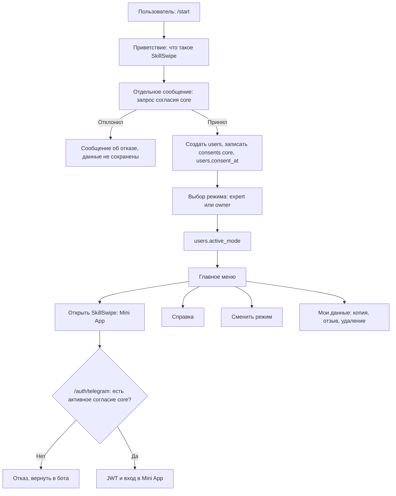

# Персональные данные в SkillSwipe: анализ и план проработки

| | |
| --- | --- |
| **Статус** | Реестр ПД (раздел 3) подготовлен по SSK-16 в упрощённом объёме на ближайшие 1.5–2 недели, остальное добавляется по мере приближения к задаче. Решения D1–D7 приняты по SSK-15. Юридическое заключение (раздел 4.5) смоделировано аналитиком: до публичного запуска заменить фактическим заключением |
| **Дата** | Создан 23.11.2026, обновлён 27.11.2026 |
| **Связанные документы** | [`total.md`](total.md) (требования, ER, API), SSK-9 (Mini App) |
| **Владелец** | Аналитик |

> Документ не является юридической консультацией. Нормы 152-ФЗ изменялись в 2025 и 2026 годах, поэтому номера статей, сроки и перечни нужно сверить по официальному тексту (КонсультантПлюс, Гарант, pravo.gov.ru) до выхода к реальным пользователям. Места, требующие проверки, помечены **(проверить)**.

## 1. Цель и область

Определить, какие персональные данные (ПД) обрабатывает SkillSwipe, на каком основании, как их хранить в БД, как получать согласие и что менять в требованиях, API и модели данных. Отдельно описан целевой процесс онбординга в боте и тексты сообщений.

**Входит:** онбординг в боте (`/start`, согласие, режим, меню), согласия и их хранение, права пользователя (отзыв, экспорт, удаление), передача данных в LLM, безопасность хранения, документы (политика, согласие).

**Не входит:** интерфейс Mini App (SSK-9), юридическое оформление оператора как организации.

**Объём.** Документ описывает целевое состояние, а очерёдность реализации задаёт раздел 3.8: сейчас делается упрощённый объём на 1.5–2 недели, отложенное записано в списке «Долг до публичного запуска».

## 2. Принятые решения

Решения приняты 23.11.2026 по задаче SSK-15 (issue #23) на основе рекомендаций аналитика и юридического заключения (раздел 4.5). Решения D3, D4 и D7 остаются **предварительными**: их нужно подтвердить проверкой цен и договора, качества извлечения навыков и значений сроков.

Два решения команды влияют на весь документ. Публичного запуска в спринтах 2 и 3 не будет: пункты «до публичного запуска» в эти спринты не входят. Навыки определяются только через ML-1 (решение по B9), ручного выбора, добавления и подтверждения навыков нет.

| № | Решение | Принято | Статус |
| --- | --- | --- | --- |
| D1 | Юрисдикция | РФ, 152-ФЗ. GDPR пока не целевой режим | Принято |
| D2 | Оператор ПД | Физическое лицо из команды как самозанятый или ИП (реквизиты `[оператор]`). Публичный запуск после выполнения условий из D2 | Принято |
| D3 | Хостинг | БД и файлы в РФ. Предварительно Yandex Cloud, альтернатива Selectel | Принято (предварительно) |
| D4 | LLM для ML-1 | ML-1 единственный способ определения навыков (ручного выбора нет, решение команды по B9), согласие `llm_processing` обязательно. Целевой вариант: российский LLM плюс псевдонимизация. OpenRouter не используется | Принято (предварительно) |
| D5 | Возраст | 18+, самодекларация в согласии | Принято |
| D6 | Сообщения удалившегося пользователя | Текст заменяется на «[удалено]», автор обнуляется | Принято |
| D7 | Срок хранения резюме | В первой версии резюме не хранится. Если хранение появится: файл до 30 дней, `extracted_text` до 7 дней, подтверждённые навыки остаются | Принято (предварительно) |

Дата принятия: 23.11.2026. Ответственный: аналитик.

### D1. Юрисдикция

**Решение:** пользователи в РФ, применяется 152-ФЗ. GDPR не является целевым режимом.

**Обоснование:** язык, аудитория и тексты проекта российские. Пересмотреть решение, если сервис начнут ориентировать на пользователей из ЕС (языки интерфейса, маркетинг, платежи в евро) или если юрист сочтёт, что GDPR применим.

### D2. Оператор ПД

**Решение:** оператором выступает **физическое лицо из команды, зарегистрированное как самозанятый или ИП**. ФИО или наименование и контакты вносит команда вместо плейсхолдера `[оператор]`. Если организация (вуз, курс, заказчик) согласится стать оператором, она заменяет это решение, остальные пункты не меняются.

**Основание (раздел 4.5, вопрос 1):** оператором может быть любое юридическое или физическое лицо, статус самозанятого не освобождает от обязанностей оператора. Оператор указывается в согласии и политике, отвечает за обработку и подаёт уведомление в Роскомнадзор (ст. 22) до начала обработки.

**Рассмотренные варианты:**

| Вариант | Плюсы | Минусы | Вывод |
| --- | --- | --- | --- |
| Участник команды как физлицо без статуса | Не нужно оформление | Личная ответственность, личные контакты в публичных документах | Не выбран |
| Самозанятый или ИП из команды | Отдельный статус, деловые контакты, быстрое оформление | Остаётся личная ответственность | **Выбран** |
| Организация (вуз, курс, заказчик) | Организационная ответственность | Долгое согласование, нужны юристы организации | Подходит при согласии организации |

**Условия публичного запуска.** До их выполнения допускаются только закрытое тестирование и синтетические данные:
1. Оператор назван, реквизиты внесены в согласие, политику и сообщения бота.
2. Подано уведомление об обработке (ст. 22).
3. Принято решение по чату: уведомление как организатор распространения информации или прямой диалог (раздел 4.5, вопрос 2).
4. Опубликованы политика и условия обработки данных, разрешённых для распространения (раздел 4.5, вопрос 3).

### D3. Хостинг в РФ

**Решение:** БД и файловое хранилище размещаются на серверах в РФ (ч. 5 ст. 18 152-ФЗ).

**Предварительный выбор:** Yandex Cloud. Для MVP достаточно виртуальной машины с Docker Compose (как сейчас). Object Storage понадобится, только если резюме начнут храниться (в первой версии нет, ответ B5 в разделе 3.8). При переходе на управляемую БД использовать Managed Service for PostgreSQL с расширением `vector`.

**Альтернатива:** Selectel (управляемый сервис PGVector, объявлен в сентябре 2026).

**Обоснование:**
- В `docker-compose.yml` сейчас стоит обычный `postgres:17` без `pgvector`, а эмбеддинги нужны для ML-2. Для стендов нужен образ с расширением (например, `pgvector/pgvector:pg17`) или управляемая БД с ним.
- Yandex Cloud документирует расширение `vector` для управляемого PostgreSQL ([документация](https://yandex.cloud/ru/docs/managed-postgresql/operations/extensions/vector)), а у Selectel появился [управляемый PGVector](https://www.cnews.ru/news/line/2026-09-28_selectel_predstavil_upravlyaemyj).
- У Yandex Cloud есть и российские LLM (Yandex AI Studio), что упрощает вариант A из D4: один провайдер для БД, файлов и модели.

**Условия до оформления (проверить):** цена и наличие грантов для учебных проектов, регион размещения данных, договор и сведения о размещении, шифрование и бэкапы, доступность Object Storage с приватным доступом.

### D4. Вариант LLM для ML-1

**Решение:**
1. ML-1 единственный способ определения навыков (решение команды по B9): ручного выбора, добавления и подтверждения навыков нет. Поэтому согласие `llm_processing` обязательно перед первой отправкой текста (резюме, описания профиля или проекта). Запасной путь при недоступности LLM: извлечение навыков по справочнику и синонимам без LLM.
2. Целевой вариант для ML-1: **A**, российский LLM-провайдер (например, Yandex AI Studio или GigaChat; доступность моделей и условия проверить) вместе со слоем псевдонимизации **B**.
3. Вариант **C** (OpenRouter как есть) не используется, пока не выполнены условия: уведомление по ст. 12, сведения о получателях и странах, согласие `llm_processing`.

**Обоснование:** при российском провайдере и хостинге в РФ отдельная трансграничная передача для ML-1 не планируется, а значит снимается самая тяжёлая часть регуляторики. Это меняет текущее описание стека в `total.md`, где основным указан OpenRouter.

**Условия подтверждения:** ML-инженеры проверяют качество извлечения на 30 размеченных примерах после маскирования (NFR-07: precision и recall не ниже порога, значение TBD) и оценивают стоимость и лимиты выбранной модели. Если качество недостаточно, вернуться к решению и рассмотреть вариант C с выполнением всех условий. Так как ручного пути нет, качество и доступность ML-1 критичны для всего сервиса. При выборе провайдера проверить, что условия договора не позволяют использовать передаваемые тексты для обучения моделей (риск по п. 4.3 Telegram Bot Developer Terms: запрещён сбор данных для создания моделей машинного обучения и AI-продуктов).

### D5. Возраст

**Решение:** сервис для лиц 18+. Возраст подтверждается самодекларацией в тексте согласия. Документальная проверка возраста не выполняется.

### D6. Сообщения удалившегося пользователя

**Решение:** при удалении аккаунта текст сообщений заменяется на «[удалено]», ссылка на автора обнуляется. Время сообщения и принадлежность к мэтчу сохраняются, чтобы не ломать чат собеседника.

**Обоснование:** текст может содержать ПД удалившегося пользователя. Альтернатива (оставить как есть) не соответствует требованию об уничтожении данных после отзыва согласия. Решение действует, пока сохраняется ретрансляция сообщений: если команда выберет статус организатора распространения информации, нужно проверить, не конфликтует ли обязанность хранения с удалением текста (раздел 4.5, вопрос 2).

### D7. Сроки хранения резюме

**Решение:** в первой версии резюме не хранится (файл читается в памяти, текст после разбора не сохраняется, ответ B5 в разделе 3.8). Если хранение появится, действуют правила ниже.
- файл резюме в хранилище удаляется после подтверждения пользователем навыков, но не позднее 30 дней после загрузки;
- `resumes.extracted_text` и `resumes.extracted_data` (JSONB) очищаются после подтверждения навыков, но не позднее 7 дней после извлечения;
- `resumes.original_filename` удаляется вместе с файлом;
- подтверждённые навыки остаются в `user_skills`.

**Обоснование:** минимизация данных. Значения 30 и 7 дней предложены аналитиком и подтверждаются командой. **В первой версии резюме не хранятся** (ответ B5 в разделе 3.8), поэтому D7 вступает в силу, только если хранение появится. Способ реализации (удаление строки `resumes` или обнуление полей) определяет backend; в таблице `s3_key` и `original_filename` сейчас обязательные поля.

### Последствия решений для других задач

| Задача | Что меняется |
| --- | --- |
| Реестр ПД | Использовать сроки из D7 и фактические имена полей `resumes` |
| Политика, согласие, тексты бота | Реквизиты оператора из D2 (`[оператор]`). Отдельное согласие на публикацию профиля по ст. 10.1 (раздел 8.10). Согласие на ИИ запрашивается при загрузке резюме |
| Требования в `total.md` | Описание стека ML-1 (вместо OpenRouter российский провайдер), NFR-06, NFR-21 |
| ML | Оценить российских LLM-провайдеров на 30 размеченных примерах, подготовить псевдонимизацию |
| Безопасность и инфраструктура | Выбрать провайдера (D3), заменить образ БД на образ с `pgvector`, настроить шифрование и бэкапы |
| Регуляторика | Уведомление по ст. 12 не планируется (российский LLM и хостинг в РФ). Уведомление об обработке (ст. 22) подаётся оператором до публичного запуска. По чату решение между статусом ОРИ и прямым диалогом (раздел 4.5) |
| Модель данных | В `consents` добавить `scope`, `subject_hash`, `user_id` допускает NULL (раздел 6.1). Таблица заблокированных хэшей |
| Чат (FR по чату) | До публичного запуска выбрать ретрансляцию с уведомлением ОРИ или прямой диалог после мэтча |

## 3. Реестр ПД и сроки хранения

Версия по SSK-16 (issue #24). Сверена с миграциями `ssk-2`, `ssk-4`, `ssk-13` по состоянию на 23.11.2026. Реализованные таблицы разобраны по полям, будущие по сущностям из ER. Объём работ ограничен ближайшими 1.5–2 неделями, остальное добавляется по мере приближения к задаче (раздел 3.8, список «Долг до публичного запуска»). Ответы backend на вопросы перенесены в раздел 3.8. Сроки для `event_log`, `llm_call`, `report` и логов остаются предложениями аналитика и вступают в силу с появлением этих таблиц.

### 3.1. Как читать реестр

- **Источники:** фактическая схема (`migrations/changelogs/`) и ER из `total.md` (раздел 10). Статус таблицы: **есть в БД** или **запланирована** (есть в ER, но нет в миграциях).
- **ПД:** **Да** (прямо идентифицирует пользователя или содержит его данные), **Косв.** (связывает с пользователем или выводится из его данных), **Нет**.
- **Основание** (ст. 6 152-ФЗ): **Согл.** согласие `core`; **Согл. 10.1** согласие на распространение (`profile_publication`); **ЗИ** законный интерес оператора или третьих лиц, применяется только для блокировок, журнала согласий и жалоб **(проверить формулировку у юриста)**; **Служ.** служебное поле без самостоятельной ценности.
- **Доступ:** **App** сервис backend; **DBA** администратор БД оператора; **ML** модуль ML-1 и ML-2 (только псевдонимизированный текст). У аналитика и остальной команды доступа к ПД в production нет, они работают с синтетикой и агрегатами. В первой версии у приложения одна роль БД, отдельные роли добавятся до публичного запуска (ответ B15 в разделе 3.8).
- **Правило актуальности:** каждый PR с миграцией, затрагивающей ПД, обновляет этот раздел (входит в критерии готовности такого PR).

### 3.2. Таблицы, которые уже есть в БД

**`users`** (`ssk-4`)

| Поле | Тип | ПД | Цель | Основание | Срок хранения | Доступ | Примечание |
| --- | --- | --- | --- | --- | --- | --- | --- |
| `id` | BIGINT, PK | Косв. | Внутренний ключ | Служ. | Пока аккаунт активен | App, DBA | |
| `telegram_id` | BIGINT, UNIQUE, NOT NULL | Да | Идентификация, вход, отправка сообщений ботом | Согл. | Пока аккаунт активен | App, DBA | После удаления только посоленный хэш в блокировках (12 месяцев), если пользователь был заблокирован |
| `username` | TEXT | Да | Связь с собеседником после мэтча (US-22) | Согл., показ по `username_visibility` | Пока аккаунт активен | App | Обновляется при `/start` и входе, сейчас никому не показывается (ответ B2 в разделе 3.8) |
| `language` | TEXT | Косв. | Язык интерфейса (US-21) | Согл. | Пока аккаунт активен | App | Добавляется сейчас: `ru` или `en` (ответ B1 в разделе 3.8) |
| `active_mode` | TEXT | Косв. | Режим ленты (`expert` или `owner`) | Согл. | Пока аккаунт активен | App | Добавляется `CHECK` по значениям (ответ B3 в разделе 3.8) |
| `consent_at` | TIMESTAMPTZ | Косв. | Кэш времени согласия `core` | Служ. | Пока аккаунт активен | App, DBA | Источник правды: `consents` (раздел 6.1) |
| `created_at` | TIMESTAMPTZ | Косв. | Служебное | Служ. | Пока аккаунт активен | App, DBA | |

**`resumes`** (`ssk-4`, связь с `users` по `user_id`, `ON DELETE CASCADE`, одно резюме на пользователя)

| Поле | Тип | ПД | Цель | Основание | Срок хранения | Доступ | Примечание |
| --- | --- | --- | --- | --- | --- | --- | --- |
| `id` | BIGINT, PK | Нет | Внутренний ключ | Служ. | Пока есть строка | App | |
| `user_id` | BIGINT, UNIQUE, FK | Косв. | Связь с владельцем | Служ. | Пока есть строка | App | |
| `s3_key` | TEXT, NOT NULL | Косв. | Путь к файлу резюме в хранилище. **Сам файл содержит высокий риск ПД** | Согл. | В первой версии не хранится. Если хранение появится: до подтверждения навыков, не позднее 30 дней (D7) | App | В первой версии не заполняется, поле станет необязательным. Каскад БД не удаляет файл из S3 (ответ B5 в разделе 3.8) |
| `original_filename` | TEXT, NOT NULL | Да | Показ имени файла пользователю | Согл. | Не храним: колонка переименовывается в `file_ext`, хранится только расширение | App | Имя часто содержит ФИО (ответ B8 в разделе 3.8) |
| `extracted_text` | TEXT | Да, **высокий риск** | Извлечение навыков (ML-1) | Согл., для LLM ещё `llm_processing` | В первой версии не сохраняется. Если хранение появится: не позднее 7 дней (D7) | App, ML (после маскирования) | Телефон, email, места работы |
| `extracted_data` | JSONB | Да, **высокий риск** | Результат извлечения для подтверждения навыков | Согл., для LLM ещё `llm_processing` | Только навыки и уверенность, пока аккаунт активен; удаляется вместе с аккаунтом | App | Структуру согласует ML-1, цитаты из резюме, имена, работодатели и контакты запрещены (ответ B6 в разделе 3.8) |
| `processing_status` | TEXT, NOT NULL | Нет | Состояние обработки | Служ. | Пока есть строка | App | Внутреннее, пользователю не показывается: `processing`, `done`, `failed` (ответ B7 в разделе 3.8) |
| `uploaded_at` | TIMESTAMPTZ | Косв. | Отсчёт сроков хранения | Служ. | Пока есть строка | App | Используется для TTL |

**`user_skills`** (`ssk-4`, `user_id` и `skill_id`, `UNIQUE (user_id, skill_id)`, `ON DELETE CASCADE` по пользователю)

| Поле | Тип | ПД | Цель | Основание | Срок хранения | Доступ | Примечание |
| --- | --- | --- | --- | --- | --- | --- | --- |
| `id` | BIGINT, PK | Нет | Внутренний ключ | Служ. | Пока аккаунт активен | App | |
| `user_id` | BIGINT, FK | Косв. | Принадлежность навыка | Согл. | Пока аккаунт активен | App | |
| `skill_id` | BIGINT, FK | Косв. | Навык из справочника. Набор навыков пользователя образует профессиональный профиль | Согл., показ в ленте по Согл. 10.1 | Пока аккаунт активен | App, ML | Без `level`, `weight`, `source`; `level` во второй версии (ответ B9 в разделе 3.8) |

Строки `resumes` и `user_skills` удаляются каскадом вместе с пользователем. Сроки хранения резюме из D7 действуют, только если хранение появится. Файл и текст резюме существуют только во время обработки и передаются LLM-провайдеру по поручению оператора с согласием `llm_processing` (D4).

**Справочники без ПД:** `skills` и `skill_synonyms` (`ssk-4`, наполнение `ssk-13` из `data/`). Хранятся бессрочно, обновляются миграциями. Служебная таблица Liquibase `public.databasechangelog` ПД не содержит.

### 3.3. Запланированные таблицы (есть в ER, нет в миграциях)

Эти таблицы сейчас не создаются. Реестр зафиксирован заранее, чтобы при появлении миграций не пересматривать подход, и уточняется вместе с ними.

| Таблица | Поля с ПД | ПД | Цель | Основание | Срок хранения | Доступ | Действие |
| --- | --- | --- | --- | --- | --- | --- | --- |
| `users` (дополнение) | `first_name`, `language`, `status` | `first_name` Да, `language` и `status` Косв. | Язык интерфейса (US-21), блокировка | Согл. | Пока аккаунт активен | App | `first_name` не хранить (минимизация), `language` добавляется сейчас, `status` позже (ответ B1 в разделе 3.8) |
| `expert_profile` | `full_name`, `bio`, `experience_years`, `hours_per_week`, `participation_format` | Да | Профиль эксперта | Согл.; поля ленты по Согл. 10.1 | Пока аккаунт активен | App | `full_name` показывать только после мэтча. `bio` свободный текст: ограничить длину |
| `project` | `title`, `description`, `stage`, `participation_format`, `status`, `owner_id` | Да (свободный текст может содержать ПД третьих лиц) | Карточка проекта | Согл.; показ в ленте по Согл. 10.1 | Пока аккаунт владельца активен | App | Предупреждение в форме: не указывать контакты и ПД третьих лиц |
| `expert_skill`, `project_skill` | `level`, `weight`, `source` | Косв. | Подбор | Согл. | Пока аккаунт активен | App, ML | См. ответ B9 в разделе 3.8 |
| `swipe` | `expert_id`, `project_id`, `actor_side`, `direction`, `created_at` | Да (поведение) | Лента и мэтчи | Согл. | Пока аккаунт активен; при отмене свайпа до мэтча запись удаляется | App | Профилирование: раскрыть в политике |
| `match` | `expert_id`, `project_id`, `status` | Косв. | Связь пары | Согл. | Пока аккаунт любой из сторон активен | App | При удалении одной стороны мэтч удаляется каскадом |
| `message` | `text`, `sender_id`, `tg_message_id`, `sent_at`, `delivered_at` | Да, **высокий риск** (тайна переписки) | Общение | Согл. | Пока есть мэтч и аккаунты; текст удалившегося пользователя заменяется на «[удалено]» (D6) | App | Шифрование поля `text` приложением. Решение по чату: раздел 4.5, вопрос 2 |
| `report` | `reason`, `reporter_id`, `target_user_id`, `target_project_id` | Да (свободный текст, данные третьих лиц) | Модерация | ЗИ | **12 месяцев после решения по жалобе**, затем удаление (предложение) | App, DBA | Ссылки на пользователей обнуляются при удалении аккаунта (правило 6 ER) |
| `recommendation_score` | `expert_id`, `project_id`, `score`, `model_version`, `computed_at` | Косв. | Кэш ранжирования | Согл. | Пока аккаунт активен; записи старых версий модели заменяются при пересчёте | App, ML | Производная от профилирования |
| `embedding` | `owner_type`, `owner_id`, `vector` | Да (производные от ПД) | Ранжирование | Согл. | Пока аккаунт активен | App, ML | Предложено заменить `owner_id` на два FK с `ON DELETE CASCADE` (ответ B10 в разделе 3.8); без FK нужно явное удаление в сервисе |
| `event_log` | `user_id`, `event_type`, `payload` (JSONB) | Косв.; `payload` не должен содержать текстов ПД | Продуктовые метрики | Согл. | **12 месяцев** (предложение); `user_id` обнуляется при удалении аккаунта | App, DBA | Белый список полей `payload` (ответ B12 в разделе 3.8) |
| `llm_call` | `user_id`, `input_hash`, `purpose`, `model`, `tokens`, `cost`, `latency_ms`, `status` | Косв.; текст запроса не хранится | Лимиты на пользователя, отладка | Согл. | **90 дней** (предложение); `user_id` обнуляется при удалении | App, DBA | Хранится только хэш входа |
| `user_block` | `blocker_id`, `blocked_id` | Косв. | Скрытие пользователей | Согл. | Пока аккаунты обеих сторон активны | App | Каскад при удалении любой из сторон |
| `bot_start` | `user_id`, `bot_type`, `started_at`, `can_message` | Косв. | Доставка сообщений ботами | Согл. | Пока аккаунт активен | App | |
| `consents` (новая, раздел 6.1) | `user_id`, `consent_type`, `document_version`, `document_hash`, `scope`, `granted_at`, `revoked_at`, `subject_hash` | Да (доказательство согласия) | Подтверждение законности обработки | Служ., ЗИ | Пока аккаунт активен, затем обезличенная запись **3 года** (раздел 4.5, вопрос 5) | App, DBA | Сейчас упрощённая версия с каскадным удалением (раздел 3.10). Целевая схема: `user_id` обнуляется, заполняется `subject_hash` |
| `blocked_subjects` (новая) | `subject_hash`, `created_at`, `expires_at` | Да (хэш `telegram_id`, псевдонимизация) | Защита других пользователей от повторного входа заблокированных | ЗИ | **12 месяцев** (раздел 4.5, вопрос 5) | App, DBA | Указывается в политике |

### 3.4. Сводка сроков хранения

| Категория | Срок | Источник решения |
| --- | --- | --- |
| Аккаунт, профиль, навыки, проекты, свайпы, мэтчи, оценки, эмбеддинги | Пока аккаунт активен; удаление в течение 30 дней после отзыва согласия или удаления аккаунта | NFR-06 |
| Файл резюме | В первой версии не хранится. Если хранение появится: до подтверждения навыков, не позднее 30 дней | D7, ответ B5 |
| `extracted_text` | В первой версии не сохраняется. Если хранение появится: не позднее 7 дней | D7, ответ B5 |
| `extracted_data` | Только навыки; пока аккаунт активен | Ответ B6 |
| Сообщения чата | Пока есть мэтч и аккаунты; текст удалившегося пользователя заменяется на «[удалено]» | D6 |
| Журнал согласий | Сейчас удаляется вместе с аккаунтом. До публичного запуска: пока аккаунт активен, затем обезличенная запись 3 года | Раздел 4.5, вопрос 5, список «Долг до публичного запуска» |
| Хэш `telegram_id` блокировок | 12 месяцев | Раздел 4.5, вопрос 5 |
| Жалобы (`report`) | 12 месяцев после решения по жалобе | Предложение аналитика, согласовать |
| `event_log` | 12 месяцев | Предложение аналитика, согласовать |
| `llm_call` | 90 дней | Предложение аналитика, согласовать |
| Логи приложения | Без ПД; ротация не дольше 30 дней | Предложение аналитика, согласовать (NFR-22) |
| Бэкапы | Не дольше 30 дней | Раздел 6.2 |

Сроки для таблиц, которых ещё нет, вступают в силу с их появлением.

### 3.5. Расхождения ER (`total.md`) и фактической схемы

| Что | ER в `total.md` | Фактическая схема | Действие |
| --- | --- | --- | --- |
| `users.first_name` | Есть | Нет | Не добавлять (минимизация) |
| `users.language` | Есть | Нет | Добавить сейчас (ответ B1 в разделе 3.8) |
| `users.status` | Есть | Нет | Добавить позже, вместе с блокировками |
| `users.consent_at` | Нет | Есть | Добавить в ER, источник правды `consents` |
| Резюме: путь к файлу | `Resume.file_path` | `resumes.s3_key` | Привести ER к схеме. В первой версии поле не заполняется (файл не хранится), сделать необязательным (ответ B5 в разделе 3.8) |
| Резюме: текст | `Resume.parsed_text` | `resumes.extracted_text` и `resumes.extracted_data` (JSONB) | Привести ER к схеме, описать структуру JSON (ответ B6 в разделе 3.8) |
| Резюме: новые поля | Нет | `original_filename`, `processing_status` | Переименовать `original_filename` в `file_ext` (ответ B8 в разделе 3.8), добавить в ER `processing_status` со значениями `processing`, `done`, `failed` (ответ B7 в разделе 3.8) |
| Владелец резюме | `Resume.expert_id` → `ExpertProfile.user_id` | `resumes.user_id` → `users.id` | `expert_profile` сейчас не добавляем (ответ B4 в разделе 3.8) |
| Навыки пользователя | `ExpertSkill` (`level`, `weight`, `source`) и `ProjectSkill` | `user_skills` (только `user_id`, `skill_id`) | Оставить как есть, `level` добавить во второй версии, `source` и `weight` не нужны (ответ B9 в разделе 3.8). Решение команды: навыки только через ML-1, ручного выбора нет |
| Синонимы навыков | Поле `Skill.synonyms`, `Skill.category` | Таблица `skill_synonyms` с `lang`, поля `category` нет | Привести ER к схеме |
| Остальные сущности | `ExpertProfile`, `Project`, `Swipe`, `Match`, `Message`, `Report`, `RecommendationScore`, `EventLog`, `LlmCall`, `Embedding`, `UserBlock`, `BotStart` | Нет в миграциях | Реестр составлен по ER (раздел 3.3), пересмотреть при появлении миграций |
| Новые сущности | Нет | Нет | `consents` сейчас в упрощённой версии (раздел 3.10), `blocked_subjects` позже (разделы 6.1 и 4.5) |

### 3.6. Поля, о которых легко забыть

- `users.username` (ПД, публичный идентификатор в Telegram).
- `resumes.original_filename` (может содержать ФИО).
- `resumes.extracted_text` и `resumes.extracted_data` (JSONB, высокий риск).
- `resumes.s3_key` и сам файл в хранилище, если хранение появится (каскад БД его не удаляет).
- Эмбеддинги (производные от ПД) и оценки `recommendation_score`.
- `event_log.payload` и логи приложения (не должны содержать текстов ПД).
- `report.reason` и `project.description`, `expert_profile.bio` (свободный текст).

### 3.7. Что не собираем

**Не собираем:** телефон, email, паспортные данные, дату рождения, фото, геолокацию, `first_name`. Username опционален (US-22).

**Специальные категории** (здоровье, политические и религиозные взгляды и т. п., ст. 10 152-ФЗ) не собираются. Резюме может их содержать: нужно предупреждение при загрузке и фильтрация при разборе.

### 3.8. Вопросы к backend и ответы (упрощённый объём)

Принцип: сейчас делаем только то, что реализуется в ближайшие 1.5–2 недели, остальное добавляем по мере приближения к задаче. Чтобы отложенное не потерялось, оно записано в списке «Долг до публичного запуска» ниже. Ответы backend перенесены из `ssk-16-backend-questions.xlsx`; где ответа не было, принято решение по умолчанию (отмечено в столбце «Ответ backend»). Сейчас: 15 вопросов, позже: 7.

#### Что делаем сейчас и что позже (по таблицам)

| Таблица | Сейчас (1.5–2 недели) | Позже |
| --- | --- | --- |
| `users` | `language` (`ru`, `en`), `CHECK` на `active_mode`, обновление `username` при `/start` и входе, `first_name` не храним | `status` (блокировки), показ username (US-22) |
| `resumes` | Файл и текст не храним (резюме читается в памяти), `original_filename` → `file_ext`, `s3_key` необязательный, `processing_status`: `processing`, `done`, `failed`, `extracted_data` только навыки (структура с ML) | Хранение файла (S3, срок, шифрование), удаление по TTL |
| `user_skills` | Без изменений (`user_id`, `skill_id`); навыки записывает только ML-1, ручного ввода нет | `level` (вторая версия) |
| `consents` | Простая таблица: `user_id`, `consent_type` (`core`, `llm_processing`), `document_version`, `granted_at`, `revoked_at`, `ON DELETE CASCADE` | `scope` (ст. 10.1), `subject_hash`, обезличенный журнал на 3 года, `blocked_subjects`, хэш документа |
| Остальные (`expert_profile`, `project`, `swipe`, `match`, `message`, `report`, `embedding`, `event_log`, `llm_call` и др.) | Не создаём | По мере задач (T21 и далее) |

#### Вопросы и итоги

| № | Вопрос | Ответ backend | Итог на ближайшие 1.5–2 недели | Когда | Статус |
| --- | --- | --- | --- | --- | --- |
| B1 | Появятся ли `users.language` и `users.status` из ER, в какой задаче? Нужен ли `first_name`? | Ответа нет, принято по умолчанию | Добавить только `users.language` (`ru` или `en`, по умолчанию язык Telegram, иначе `ru`). `first_name` не хранить. **Позже:** `users.status` (блокировки) добавим вместе с блокировками и жалобами. | Сейчас | Решено |
| B2 | Как обновляется `users.username` при смене в Telegram и кто его показывает? | Ответа нет, принято по умолчанию | Обновлять `username` при `/start` и входе. Никому не показывать. **Позже:** Показ собеседнику и согласие `username_visibility` вместе с US-22 (Would). | Сейчас | Решено |
| B3 | Будет ли ограничение значений `active_mode`? | Ответа нет, принято по умолчанию | Одна строка `CHECK` на `active_mode` (`expert` или `owner`, до выбора режима NULL). | Сейчас | Решено |
| B4 | Когда появятся `expert_profile` и `project`? Будет ли `resumes` ссылаться на `expert_profile` вместо `users`? | `expert_profile` не добавлять: на MVP это лишнее усложнение, достаточно `users` и `resumes` | Принято. На этот период только `users`, `resumes`, `user_skills`, `skills`, `skill_synonyms`. **Позже:** `expert_profile`, `project` и связи добавим, когда начнутся профили и проекты (T21). | Сейчас | Решено |
| B5 | Какое S3-хранилище, как настроены приватность, шифрование, ключи, кто удаляет файл при удалении аккаунта и по сроку? | Локально MinIO, облако не для MVP, в первой версии резюме можно не хранить | В первой версии резюме не храним: файл читаем в памяти, текст после разбора не сохраняем, остаются только навыки. S3, сроки хранения и шифрование резюме не нужны. Это снимает главный риск по ПД. **Позже:** Если хранение понадобится: Object Storage, срок по D7, удаление файла в сервисе удаления. | Сейчас | Решено |
| B6 | Какая структура у `extracted_data` и есть ли в ней ПД? | Структуру нужно обсудить с ML, колонку добавил для них | Договориться с ML-1 о структуре. Единственное правило для ПД: в `extracted_data` только навыки и уверенность, без цитат из резюме, имён, работодателей и контактов. **Позже:** Когда структура будет известна, внести её в раздел 3.10. | Сейчас | Нужно обсудить с ML |
| B7 | Какие значения принимает `processing_status` и когда запись считается завершённой? | Пользователь не должен знать статус и ничего подтверждать не должен | `processing_status` внутренний, пользователю не показывается. Значения `processing`, `done`, `failed`, без шага `confirmed`. **Позже:** Нужно ли пользователю подтверждать предложенные ML навыки, решают требования и ML (SSK-18), к статусу это не относится. | Сейчас | Решено |
| B8 | Нужен ли `original_filename`? | Колонку можно оставить, хранить только расширение; согласен переименовать | Переименовать `original_filename` в `file_ext` и хранить только расширение (`pdf`, `docx`). Новым changelog. | Сейчас | Решено |
| B9 | Какая модель навыков: общая `user_skills` или `expert_skill` и `project_skill`? Нужны ли `level`, `weight`, `source`? | Ручной выбор не нужен, всё через ML; `source` и `weight` не нужны, `level` во второй версии | Решено командой: ручного выбора, добавления и подтверждения навыков нет, навыки определяет только ML-1 (по резюме, описанию профиля и описанию проекта). `user_skills` без изменений (`user_id`, `skill_id`), без `source`, `weight`, `level`. **Позже:** `level` во второй версии. Следствия: согласие `llm_processing` обязательно (D4); при недоступности LLM работает извлечение по справочнику и синонимам; уровень важности навыков проекта определяется ML (TBD с ML). | Сейчас | Решено |
| B10 | Как удалять эмбеддинги без внешнего ключа? | Ответа нет | Не сейчас, эмбеддингов пока нет. **Позже:** С ML-2: вместо полиморфного `owner_id` два FK с `ON DELETE CASCADE` (раздел 3.10). | Позже | Отложено |
| B11 | Какие правила `ON DELETE` будут у будущих таблиц? | Матчи во втором этапе, пока всё удалять каскадом | Для текущих таблиц (`resumes`, `user_skills`, `consents`) `ON DELETE CASCADE`. **Позже:** Противоречие каскада `match` и решения D6 вернуть, когда появятся `match` и `message`. Рекомендация: удалять мэтч и переписку у обеих сторон. | Сейчас | Решено |
| B12 | Какие события пишутся в `event_log`, можно ли ввести белый список ключей `payload`? Подходит ли срок 12 месяцев? | Ответа нет | Не сейчас, журнал событий в спринте 4 (T57). **Позже:** Список событий и ключи `payload` готовы в разделе 3.9. | Позже | Отложено |
| B13 | Достаточно ли 90 дней для `llm_call`? Нужен ли `user_id`? | Нужно для ML | Не сейчас: `llm_call` создаётся вместе с ML-задачей. **Позже:** `user_id` для лимита (NFR-13), текст запросов не хранить, срок 90 дней. | Позже | Отложено |
| B14 | Как ограничить `report.reason`, `bio`, `description` и как хранить жалобы после удаления сторон? | Жалобы это поздняя итерация, пока зафиксировать | Зафиксировано, не реализуем: причины `spam`, `abuse`, `fraud`, `inappropriate`, `other`, комментарий до 500 символов, `bio` до 1000, описание проекта до 2000. **Позже:** Вернуться вместе с профилями, проектами и жалобами. | Позже | Отложено |
| B15 | Какие роли БД планируются, кто имеет доступ к production? | Одна роль приложения, отдельные роли в БД это оверхед | Одна роль БД у приложения, отдельные роли не заводим. **Позже:** Перед публичным запуском: приложение без прав суперпользователя, миграции отдельной ролью. | Сейчас | Решено |
| B16 | Где шифруются `extracted_text` и `message.text`, где хранятся ключи? | Пока не прод, шифровать нечего | Для закрытого тестирования на синтетике шифрование не нужно. До публичного запуска обязательно шифрование данных на диске или в СУБД средствами хостинга с ключом отдельно от данных: это требование Telegram Bot ToS (п. 4.4) ко всем данным, а не только к резюме и сообщениям. **Позже:** шифрование полей `resumes.extracted_text` и `message.text` приложением, если появится хранение текстов. | Позже | Отложено |
| B17 | Можно ли на выбранном хостинге ограничить срок хранения бэкапов 30 днями? | Ответа нет | Не сейчас, бэкапы настроим при выходе в production. **Позже:** Срок не более 30 дней (в Yandex Managed PostgreSQL настраивается от 7 до 60 дней). | Позже | Отложено |
| B18 | Как организовать удаление по TTL: удалять строку `resumes` или обнулять поля? Где работает планировщик? | Ответа нет | Не нужно, пока резюме не хранятся (B5). **Позже:** Если хранение появится: удалять строку целиком, фоновая задача раз в час. | Позже | Отложено |
| B19 | Какой формат и расположение словарей сообщений (YAML, JSON, gettext) и структура ключей? | Ответа нет, принято по умолчанию | YAML `locales/ru.yaml`, плоские ключи (`onboarding.start.welcome`), плейсхолдеры `{name}`. Только `ru`. **Позже:** `en` добавится новым файлом (NFR-17), в CI проверка совпадения ключей. | Сейчас | Решено |
| B20 | Как backend загружает документы и считает хэш? | Ответа нет, принято по умолчанию | Документы лежат в `docs/legal/*.md` с версией в front matter. В `consents` пишем `document_version`. **Позже:** Хэш SHA-256 добавим, если останется время, иначе позже. | Сейчас | Решено |
| B21 | Кто владеет тремя ботами в BotFather и кто выставляет политику? | Ответа нет, принято по умолчанию | Бот создаётся под аккаунтом оператора (D2), владельца записать в README. Сейчас нужен только бот свайпов (онбординг и согласие). **Позже:** Боты чата и жалоб создаются вместе с этими функциями. | Сейчас | Решено |
| B22 | Где публикуется страница с документами и кто её поддерживает? | Ответа нет, принято по умолчанию | GitHub Pages из `docs/legal` для ссылки на политику в боте. **Позже:** Свой домен оператора до публичного запуска. | Сейчас | Решено |

#### Долг до публичного запуска

Публичного запуска в спринтах 2 и 3 не будет (решение команды), поэтому эти пункты в них не входят. Исключение: маскирование перед отправкой в LLM нужно до первой отправки реальных резюме.

| № | Что вернуть | Когда | Вопрос |
| --- | --- | --- | --- |
| 1 | Обезличенный журнал согласий: `consents.user_id` с SET NULL, `subject_hash`, хранение 3 года, таблица `blocked_subjects` | Перед публичным запуском (сейчас `consents` удаляется каскадом) | B11 |
| 2 | Хэш SHA-256 документов согласия в `consents` | Если не успеем сейчас, до публичного запуска | B20 |
| 3 | Согласия `profile_publication` (ст. 10.1, `scope`), `digest`, `username_visibility` | Вместе с функциями, которым они нужны | B2 |
| 4 | Хранение резюме: S3, срок по D7, сервис удаления, фоновая задача | Только если решим хранить резюме | B5, B18 |
| 5 | Шифрование данных at rest (диск или СУБД средствами хостинга, ключ отдельно от данных) для всех данных | До публичного запуска, обязательно (Telegram Bot ToS, п. 4.4) | B16 |
| 6 | Роли БД: приложение без прав суперпользователя, миграции отдельной ролью | Перед публичным запуском | B15 |
| 7 | Бэкапы не более 30 дней и повторное применение удалений после восстановления | При выходе в production | B17 |
| 8 | Решение по чату (уведомление как организатор распространения информации или прямой диалог) и правка D6 | Когда появятся `match` и `message` | B11 |
| 9 | Блокировки: `users.status`, `blocked_subjects` на 12 месяцев | Вместе с блокировками и жалобами | B1, B14 |
| 10 | Журнал событий (`event_log`, белый список из 3.9) и `llm_call` (90 дней) | Спринт 4 (T57) и ML-задача | B12, B13 |
| 11 | Эмбеддинги: два FK с CASCADE вместо `owner_id` | Вместе с ML-2 | B10 |
| 12 | Название оператора, уведомление в Роскомнадзор, настоящее заключение юриста, публикация политики | Перед публичным запуском (условия из D2) | — |
| 13 | Шифрование полей `resumes.extracted_text` и `message.text` приложением | Если появится хранение текстов | B16 |
| 14 | План реагирования на утечку и уведомление пользователей | До публичного запуска (Telegram Bot ToS, п. 4.4) | — |
| 15 | Маскирование телефона, email, ссылок и ФИО перед отправкой текста в LLM; выбор российского провайдера; оценка качества извлечения (NFR-07); условия провайдера: тексты не используются для обучения (п. 4.3 Telegram Bot Developer Terms) | До первой отправки реальных резюме и до публичного запуска, обязательно (ML-1 единственный путь получить навыки) | B6, B9 |

### 3.9. Перечень событий и белый список `payload`

Раздел нужен позже: журнал событий планируется в спринте 4 (T57). События взяты из раздела 13 `total.md` (метрики) и NFR-20. В `payload` разрешены только типизированные поля из таблицы. Любые строки пользователя (`bio`, названия и описания проектов, тексты сообщений, резюме, username, имена, контакты) запрещены. Схема проверяется по типу события, неизвестные ключи отбрасываются. Срок хранения 12 месяцев, `user_id` обнуляется при удалении аккаунта.

| Событие | Метрика | Разрешённые ключи `payload` |
| --- | --- | --- |
| `login` | Retention D7 | `bot` (`swipes`, `chat`, `reports`), `new_user` (bool) |
| `profile_saved` | Заполненность профиля | `mode` (`expert`, `owner`), `skills_count` (число) |
| `skills_suggested` | Принятие ML-навыков | `count` (число), `source` (`ml`, `manual`) |
| `skills_confirmed` | Принятие ML-навыков | `accepted` (число), `rejected` (число) |
| `feed_shown` | Качество ленты | `mode`, `cards` (число), `top5_ids` (список id) |
| `swipe` | Доля свайпов вправо, конверсия | `expert_id`, `project_id`, `direction` (`left`, `right`), `actor_side` |
| `match_created` | Конверсия свайп → мэтч | `match_id` |
| `message_sent` | Доля мэтчей с диалогом | `match_id`, `length_bucket` (`lt100`, `100_500`, `gt500`) |
| `llm_call` | Стоимость LLM на пользователя | `purpose`, `model`, `tokens_in`, `tokens_out`, `cost`, `latency_ms`, `status` |
| `consent_granted`, `consent_revoked` | Аудит согласий | `consent_type`, `document_version` |

### 3.10. Заметки для миграций

Новые changelog, `ssk-4.xml` не править. Это ориентир для backend, имена и детали определяет исполнитель.

**Сейчас (1.5–2 недели):**

```sql
-- users (B1, B3)
ALTER TABLE users ADD COLUMN language TEXT NOT NULL DEFAULT 'ru' CHECK (language IN ('ru', 'en'));
ALTER TABLE users ADD CONSTRAINT users_active_mode_check
    CHECK (active_mode IS NULL OR active_mode IN ('expert', 'owner'));

-- resumes (B5, B7, B8): файл и текст не храним
ALTER TABLE resumes RENAME COLUMN original_filename TO file_ext;      -- хранить только 'pdf' или 'docx'
ALTER TABLE resumes ALTER COLUMN s3_key DROP NOT NULL;                -- файл не сохраняется
ALTER TABLE resumes ADD CONSTRAINT resumes_status_check
    CHECK (processing_status IN ('processing', 'done', 'failed'));

-- consents (простая версия, B11, B20)
CREATE TABLE consents (
    id                BIGSERIAL PRIMARY KEY,
    user_id           BIGINT      NOT NULL REFERENCES users(id) ON DELETE CASCADE,
    consent_type      TEXT        NOT NULL,   -- core, llm_processing; позже profile_publication, digest, username_visibility
    document_version  TEXT        NOT NULL,
    granted_at        TIMESTAMPTZ NOT NULL DEFAULT now(),
    revoked_at        TIMESTAMPTZ
);
CREATE UNIQUE INDEX uq_consents_active ON consents (user_id, consent_type) WHERE revoked_at IS NULL;
```

Структура `resumes.extracted_data` (B6) согласуется с ML-1. Правило для ПД: только навыки и уверенность, без цитат из резюме, имён, работодателей и контактов. Ориентир:

```json
{"skills": [{"name": "Python", "skill_id": 12, "confidence": 0.91}]}
```

**Позже (по мере появления задач):**

```sql
-- обезличенный журнал и блокировки (до публичного запуска)
--   consents: user_id BIGINT NULL REFERENCES users(id) ON DELETE SET NULL,
--             subject_hash CHAR(64), scope JSONB, document_hash CHAR(64)
--   blocked_subjects(subject_hash, created_at, expires_at)

-- users.status для блокировок
--   ALTER TABLE users ADD COLUMN status TEXT NOT NULL DEFAULT 'active' CHECK (status IN ('active', 'blocked'));

-- навыки: level во второй версии
--   ALTER TABLE user_skills ADD COLUMN level SMALLINT;

-- эмбеддинги (с ML-2): два FK вместо полиморфного owner_id
--   expert_user_id BIGINT REFERENCES users(id)   ON DELETE CASCADE,
--   project_id     BIGINT REFERENCES project(id) ON DELETE CASCADE,
--   CHECK (num_nonnulls(expert_user_id, project_id) = 1)
```

Роли БД, шифрование, бэкапы и хранение резюме перечислены в списке «Долг до публичного запуска» раздела 3.8.

## 4. Правовая карта

### 4.1. 152-ФЗ «О персональных данных»

| Тема | Требование | Что делаем |
| --- | --- | --- |
| Согласие (ст. 9) | С 1 сентября 2025 согласие оформляется отдельно от других документов и информации, которые подтверждает человек ([156-ФЗ от 24.06.2025](https://www.garant.ru/news/1850806/)). Согласие должно быть конкретным, предметным, информированным, сознательным и однозначным ([Контур](https://kontur.ru/articles/1577)). Штрафы за нарушение порядка согласия доходят до 700 тыс. руб. ([Гарант](https://www.garant.ru/article/1862510/)) | Отдельное сообщение только про согласие, без склейки с правилами и политикой. Отдельные согласия на отдельные цели (раздел 8) |
| Форма согласия | Допускается любая форма, позволяющая подтвердить факт получения ([buh.ru](https://buh.ru/articles/novyy-poryadok-oformleniya-soglasiy-na-obrabotku-personalnykh-dannykh-s-1-sentyabrya-2025-goda.html)) | Кнопка в боте плюс журнал `consents`. Обязательные элементы содержания и состав журнала: раздел 4.5, вопрос 4 |
| Политика (ст. 18.1) | Публичная политика обработки ПД | Страница вне бота, ссылка в боте, регистрация в BotFather |
| Специальные категории (ст. 10) | Обработка ограничена | Не собираем, предупреждаем в форме загрузки резюме |
| Распространение (ст. 10.1) | Для ПД, разрешённых для распространения неопределённому кругу, нужно отдельное согласие | По заключению юриста показ профиля в ленте оформляется как согласие на распространение (раздел 4.5, вопрос 3). Требования к содержанию: [приказ Роскомнадзора от 24.02.2021 № 18](https://www.klerk.ru/doc/558708/) |
| Трансграничная передача (ст. 12) | С 1 марта 2023 уведомление Роскомнадзора о передаче в любую страну ([Клерк](https://www.klerk.ru/blogs/moedelo/567870)). Начинать передачу можно после 10 рабочих дней на рассмотрение ([pravo.ru](https://pravo.ru/opinion/266312/)) | Если ML-1 использует зарубежный LLM, подаём уведомление до начала передачи, получаем сведения от получателя. По данным [Состава](https://www.sostav.ru/blogs/293571/113022), Федеральный закон от 26.07.2026 № 265-ФЗ изменил определение «адекватных» стран, проект нового перечня Роскомнадзора на конец сентября 2026 подписан не был **(проверить актуальный статус)** |
| Локализация (ч. 5 ст. 18) | Первичная запись, хранение и накопление ПД граждан РФ на серверах в РФ ([Клерк](https://www.klerk.ru/user/2548465/716829/)) | БД и файловое хранилище в РФ |
| Уведомление об обработке (ст. 22) | Подают [все операторы](https://habr.com/ru/post/914414), включая ИП и самозанятых | Подать до выхода к реальным пользователям |
| Права субъекта (ст. 14, 21) | Ответ на запрос о данных в течение [10 рабочих дней](https://www.klerk.ru/blogs/fedresurs/679821). При отзыве согласия прекращение обработки и уничтожение данных (по моим данным, 30 дней, совпадает с NFR-06) | Эндпоинты отзыва, экспорта и удаления, регламент ответов на запросы **(проверить срок ст. 21)** |
| Утечки | Уведомление Роскомнадзора об инциденте в короткие сроки (по моим данным, 24 часа и 72 часа) | План реагирования на инциденты **(проверить сроки)** |
| Организатор распространения информации (ст. 10.1 149-ФЗ) | К организаторам относятся в том числе мессенджеры. Обязанности: [уведомить Роскомнадзор о начале деятельности, хранить определённые данные, содействовать органам безопасности](https://www.advgazeta.ru/ag-expert/advices/arkhivnuyu-obyazannost-vladeltsev-saytov-i-prilozheniy-obnovili/). За неуведомление штраф до 300 тыс. руб., за повторное до 1 млн руб. | Решение по чату до публичного запуска (раздел 4.5, вопрос 2) |

### 4.2. Правила Telegram Bot Platform

По [Bot Developer Terms](https://telegram.org/tos/bot-developers?setln=en):

- Нужна политика конфиденциальности, [доступная пользователям](https://telegram.org/tos/bot-developers?setln=es); её регистрируют в BotFather, у Mini App в настройках появится кнопка Privacy Policy.
- Данные, присланные пользователем, можно использовать при [информировании и индивидуальном, явном, активном и отзываемом согласии](https://telegram.org/tos/bot-developers?setln=ar).
- Запрещено собирать и хранить данные сверх необходимого.
- Минимум по безопасности: [шифрование данных at rest с хранением ключа отдельно, оповещение пользователей об утечках](https://telegram.org/tos/bot-developers?setln=nl).
- Данные удаляются по запросу пользователя.
- Нарушения ведут к отключению бота.

### 4.3. GDPR (если будут пользователи из ЕС)

- Правовое основание (ст. 6), условия согласия (ст. 7), информирование (ст. 13), права субъекта (ст. 15–22).
- Договор с обработчиком, в том числе с LLM-провайдером (ст. 28), передача в третьи страны (ст. 44 и далее).
- Privacy by design (ст. 25), реестр обработки (ст. 30), безопасность (ст. 32).
- Уведомление об утечке за 72 часа (ст. 33), оценка воздействия DPIA для профилирования (ст. 35).
- Возраст согласия зависит от страны (для Австрии 14 лет).

### 4.4. Вопросы для юриста

1. Кто может быть оператором ПД (организация, ИП или самозанятый, физлицо).
2. Бот-ретранслятор между пользователями (чат) может подпадать под правила о сервисах обмена мгновенными сообщениями (149-ФЗ).
3. Нужно ли оформлять показ профиля в ленте как согласие на распространение (ст. 10.1).
4. Какие реквизиты ч. 4 ст. 9 требуются при согласии кнопкой.
5. Срок и основание хранения журнала согласий и хэша `telegram_id` для блокировок после удаления аккаунта.
6. Дайджест (US-19): нужно ли отдельное согласие по 38-ФЗ, если в нём появится реклама.

### 4.5. Заключение юриста по вопросам 4.4

> **Смоделировано аналитиком.** Ответы сформулированы как ожидаемое заключение квалифицированного юриста на основе открытых источников и нужны, чтобы довести процесс до конца. До публичного запуска заменить фактическим заключением (ФИО, дата) или подтвердить. Формулировки на уровне статей сверить по действующим текстам.

**Вопрос 1. Оператор.**
Оператором может быть любое юридическое или физическое лицо, определяющее цели и способы обработки. Статус самозанятого от обязанностей оператора не освобождает. Оператор указывается в согласии и политике, подаёт уведомление в Роскомнадзор (ст. 22) до начала обработки (его [должны подавать все операторы](https://habr.com/ru/post/914414), включая ИП и самозанятых).
*Решение:* оператор: самозанятый или ИП из команды, при согласии организации вместо него организация (D2).

**Вопрос 2. Чат через бота.**
Ретрансляция сообщений между пользователями по функции близка к сервису обмена сообщениями. Мессенджеры относятся к организаторам распространения информации (ст. 10.1 149-ФЗ), у которых [три базовые обязанности](https://www.advgazeta.ru/ag-expert/advices/arkhivnuyu-obyazannost-vladeltsev-saytov-i-prilozheniy-obnovili/): уведомить Роскомнадзор о начале деятельности, хранить определённые данные и сотрудничать с органами безопасности. Штраф за неуведомление до 300 тыс. руб., за повторное до 1 млн руб. Объём и срок хранения (в источниках встречается срок в три года вместо одного после изменений закона) нужно проверить по действующему тексту.
Варианты:
- (а) оставить ретрансляцию, подать уведомление как организатор и обеспечить хранение. Хранение может конфликтовать с удалением текста сообщений (D6).
- (б) для снижения риска перейти на прямой диалог в Telegram после взаимного мэтча с согласия обеих сторон (без ретрансляции и хранения текста).

*Решение:* для закрытого тестирования ретрансляция сохраняется. Выбор между (а) и (б) обязателен до публичного запуска (условие 3 из D2). Отдельно отслеживать ограничения на использование иностранных мессенджеров (41-ФЗ): по вторичному источнику они [распространяются на перечисленные категории организаций](https://mosdigitals.ru/blog/zapret-na-ispolzovanie-inostrannyh-messendzherov-aktualnye-ogranicheniya-2026-goda-i-otvetstvennost-biznesa); применимость к SkillSwipe не подтверждена.

**Вопрос 3. Профиль в ленте.**
Распространение — это действия, направленные на раскрытие данных неопределённому кругу лиц (п. 5 ст. 3 152-ФЗ). Профиль виден любому, кто принял согласие в боте, поэтому его нужно считать распространением. Нужно отдельное согласие по ст. 10.1: молчание не считается согласием, письменная форма не обязательна, требования к содержанию установлены [приказом Роскомнадзора от 24.02.2021 № 18](https://www.klerk.ru/doc/558708/). Субъект вправе установить условия и запреты на обработку, а оператор обязан [опубликовать информацию об условиях и запретах не позднее 3 рабочих дней](https://www.fbk.ru/upload/iblock/0f5/Полякова_Обработка%20ПДн_изменения%20в%20зак-ве__28.07.2022.pdf) с момента получения согласия.
*Решение:* согласие `profile_publication` оформляется отдельным экраном (раздел 8.10) с перечнем категорий (о себе, опыт, навыки, доступность), без фамилии, username и контактов; условие: показ только внутри SkillSwipe, запрет копирования и передачи третьим лицам. Состав выбора хранится в `consents.scope`. Условия публикуются на странице документов в течение 3 рабочих дней после получения согласия.

**Вопрос 4. Реквизиты согласия кнопкой.**
Форма согласия может быть любой, позволяющей подтвердить факт получения. Согласие должно быть [конкретным, предметным, информированным, сознательным и однозначным](https://kontur.ru/articles/1577). ФИО и паспортные данные не нужны, так как оператор их не собирает, а пользователь идентифицируется по Telegram ID. Обязательные элементы текста: оператор и контакты, цели, перечень данных, действия и способы обработки, получатели и лица, обрабатывающие данные по поручению (хостинг, при включении ИИ также LLM-провайдер), срок, порядок отзыва. Подтверждение получения согласия лежит на операторе (ч. 3 ст. 9).
*Решение:* в журнале хранятся версия и хэш текста, время, `user_id`, `message_id` сообщения с кнопкой, язык. Состав элементов текста закреплён в разделах 8.2 и 8.11. Список элементов сверить с ч. 4 ст. 9 в действующей редакции.

**Вопрос 5. Журнал согласий и хэш `telegram_id`.**
Так как доказывать получение согласия должен оператор, после удаления аккаунта запись журнала хранится в обезличенном виде: `user_id` обнуляется, добавляется посоленный хэш, остаются тип, версия документа, время выдачи и отзыва. Срок: 3 года (общий срок исковой давности, ст. 196 ГК РФ), затем удаление. Хэш `telegram_id` для блокировок хранится на основании законного интереса защиты других пользователей. Срок: 12 месяцев, отражается в политике. Такой хэш остаётся персональными данными (это псевдонимизация, а не обезличивание).
*Решение:* `consents` не удаляется каскадом, а обезличивается (раздел 6.1). Блокировки хранятся в отдельной таблице с полем срока.

**Вопрос 6. Дайджест.**
Дайджест подборок профилей и проектов внутри сервиса является сервисным информированием, а не рекламой. Реклама по сетям электросвязи требует предварительного согласия адресата (ч. 1 ст. 18 38-ФЗ), и [доказывать его должен рекламораспространитель](https://www.klerk.ru/user/2651996/718408/).
*Решение:* дайджест без рекламы, включается отдельным согласием `digest`. Рекламные материалы допускаются только после отдельного согласия.

**Дополнительно.**
- Уведомление по ст. 12 не планируется: ML-1 использует российский LLM, БД и файлы размещены в РФ. Взаимодействие через Telegram как канал связи указывается в политике, остаточный риск отслеживается.
- Уведомление об обработке (ст. 22) подаётся до публичного запуска.

## 5. Целевой процесс онбординга



Что меняем относительно исходного видения:

1. **`users` создаётся только после согласия.** До этого состояние диалога хранится в FSM (память или Redis с TTL). Тогда фраза в сообщении об отказе «мы ничего не сохранили» остаётся верной.
2. **Одного `users.consent_at` недостаточно.** Нужен журнал согласий с версией документа (раздел 6.1). Поле `users.consent_at` остаётся как кэш основного согласия.
3. **Согласие в отдельном сообщении**, без других документов и без галочек по умолчанию (требование ст. 9).
4. **Consent gate на backend.** Проверка в боте недостаточна: `/auth/telegram` не выдаёт JWT без активного согласия `core`.
5. **Ссылка на политику** в боте, в меню и в BotFather. Режим (`active_mode`) не относится к специальным категориям.
6. **Дополнительные согласия запрашиваются в момент использования функции:** публикация профиля при сохранении профиля, ИИ при загрузке резюме, дайджест при его включении, username при включении US-22.
7. **Язык.** Тексты согласия и меню хранятся во внешних словарях (NFR-17) и версионируются.

## 6. Хранение в БД

### 6.1. Таблица согласий

Целевая схема для публичного запуска. В ближайшие 1.5–2 недели создаётся упрощённая версия (раздел 3.10): без `scope`, `subject_hash`, `document_hash`, `language`, `source` и с каскадным удалением `user_id`.

```sql
CREATE TABLE consents (
    id                BIGSERIAL PRIMARY KEY,
    user_id           BIGINT       REFERENCES users(id) ON DELETE SET NULL,  -- обнуляется при удалении аккаунта
    consent_type      VARCHAR(32)  NOT NULL,   -- core | llm_processing | profile_publication | digest | username_visibility
    document_version  VARCHAR(32)  NOT NULL,   -- версия текста согласия
    document_hash     CHAR(64)     NOT NULL,   -- SHA-256 текста, который видел пользователь
    language          VARCHAR(8)   NOT NULL,
    source            VARCHAR(16)  NOT NULL,   -- bot | miniapp
    scope             JSONB,                   -- для profile_publication: категории, условия и запреты
    subject_hash      CHAR(64),                -- посоленный хэш, заполняется при удалении аккаунта
    granted_at        TIMESTAMPTZ  NOT NULL DEFAULT now(),
    revoked_at        TIMESTAMPTZ
);

-- Не более одного активного согласия каждого типа на пользователя
CREATE UNIQUE INDEX uq_consents_active
    ON consents (user_id, consent_type)
    WHERE revoked_at IS NULL;
```

В целевой схеме при удалении аккаунта запись `consents` не удаляется, а обезличивается: `user_id` обнуляется, заполняется `subject_hash`, запись хранится 3 года (раздел 4.5, вопрос 5), затем удаляется. Файл миграции Liquibase оформляется как `migrations/changelogs/ssk-XX.xml` и подключается в `master.yaml`.

### 6.2. Правила хранения

В скобках указано, когда правило вступает в силу.

1. **Минимизация** (сейчас). Таблицы и поля только под перечисленные цели, без «на всякий случай».
2. **Резюме** (сейчас: не храним). В первой версии файл читается в памяти, текст после разбора не сохраняется, остаются только навыки. Если хранение появится: файл в приватном хранилище в РФ, в БД только путь (`resumes.s3_key`), `extracted_text` очищается по сроку D7.
3. **Шифрование.** Шифрование диска или СУБД средствами хостинга, ключ отдельно от данных: до публичного запуска, обязательно для всех данных (требование Telegram Bot ToS, п. 4.4). Дополнительно шифрование полей `resumes.extracted_text` и `message.text` приложением, если появится хранение текстов. Ключи хранятся вне БД, секреты не в репозитории.
4. **Эмбеддинги** (вместе с ML-2). У `Embedding.owner_id` нет внешнего ключа, поэтому предложено два внешних ключа с `CASCADE` (раздел 3.10), иначе нужно явное удаление в сервисе и тест.
5. **Лента** (вместе с профилями). До мэтча показываем только профессиональные поля. Фамилия, username и контакты не показываются.
6. **Сообщения при удалении аккаунта** (когда появятся `message` и `match`). Текст сообщений удалившегося пользователя заменяется на «[удалено]», ссылка на пользователя обнуляется (D6). Нужно решение по каскаду `match` (ответ B11 в разделе 3.8).
7. **Блокировки** (до публичного запуска). Чтобы заблокированный пользователь не вернулся после удаления, в отдельной таблице хранится посоленный хэш `telegram_id` на 12 месяцев (законный интерес, указывается в политике; раздел 4.5, вопрос 5).
8. **Логи** (сейчас). В логах приложения, Sentry и `event_log.payload` нет текстов профилей, резюме и сообщений. В `llm_call` только `input_hash`, модель, токены, стоимость, статус.
9. **Бэкапы** (при выходе в production). Срок ротации не превышает срок удаления данных (30 дней).
10. **Доступ** (сейчас: одна роль приложения; роли до публичного запуска). На dev и в тестах только синтетика, на демонстрациях без реальных профилей.
11. **Удаление** (сейчас, каскадом). Срок по NFR-06 (30 дней). Ответ на запрос пользователя о его данных не позднее 10 рабочих дней.

### 6.3. Новые и изменяемые эндпоинты

| Метод | Путь | Описание | Когда |
| --- | --- | --- | --- |
| POST | `/auth/telegram` | Доработать: отказ без активного согласия `core` | Сейчас |
| POST | `/consents` | Записать согласие (тип, версия документа); сначала вызывается из онбординга бота | Сейчас |
| DELETE | `/users/me` | Удаление аккаунта каскадом (отзыв согласия `core` равен удалению) | Сейчас |
| POST | `/consents/{type}/revoke` | Отзыв остальных согласий | Позже |
| GET | `/users/me/consents` | Список согласий пользователя | Позже |
| GET | `/users/me/data-export` | Выгрузка данных пользователя (US-26) | Позже |

Позже в `DELETE /users/me` добавятся явное удаление `embedding` и обезличивание `message`.

Команды бота: `/privacy`, раздел меню «Мои данные».

## 7. LLM и трансграничная передача

Вызов OpenRouter с текстом резюме или профиля может считаться трансграничной передачей ПД. Кроме того, OpenRouter перенаправляет запрос провайдерам моделей, поэтому получателей и стран может быть несколько. Варианты:

| Вариант | Плюсы | Минусы |
| --- | --- | --- |
| A. Российский LLM для ML-1 (YandexGPT, GigaChat) | Нет трансграничной передачи | Нужно проверить качество на размеченной выборке, возможны платные тарифы |
| B. Псевдонимизация перед отправкой | Меньше риска и данных у получателя | Резюме полностью не обезличить, остаётся остаточный риск, нужна реализация и тесты |
| C. OpenRouter как есть | Быстрее всего | Уведомление в РКН по ст. 12, получение сведений от иностранных получателей, согласие на ИИ, самый тяжёлый вариант |

**Рекомендация:**

1. ML-1 единственный способ определения навыков (решение команды по B9), ручного выбора нет. Согласие `llm_processing` обязательно: без него навыки не определяются.
2. Согласие `llm_processing` запрашивается при первой отправке текста (резюме, описания профиля или проекта), а не при `/start`.
3. Перед отправкой в LLM скрываются: телефоны, email, ссылки (LinkedIn, GitHub, `@username`), ФИО, адреса, даты рождения.
4. Если остаётся зарубежный LLM, до начала передачи подаётся уведомление по ст. 12 (вариант C).

NFR-06 приведён в соответствие в `docs/total.md` (SSK-18).

**Принято по SSK-15 (предварительно):** целевой вариант A плюс B, вариант C не используется. Подробности и условия в разделе 2 (D4). Решение B9 сделало согласие обязательным; запасной путь при недоступности LLM: извлечение по справочнику и синонимам.

## 8. Тексты бота (черновики)

Плейсхолдеры в `[скобках]` заполняются после решений из раздела 2. Лимит одного сообщения Telegram 4096 символов, полный текст согласия и политика публикуются на странице вне бота.

Тексты рассчитаны на публичный запуск. В первой версии (онбординг, согласие `core`, выбор режима, меню) нужны сообщения 8.1–8.8, а 8.9 и 8.10 понадобятся, когда появятся отправка резюме в LLM и публикация профиля. В тексте согласия 8.2 пункты про свайпы, мэтчи и чат можно временно убрать, пока этих функций нет.

### 8.1. Ответ на /start

> 👋 Привет! Это **SkillSwipe**: сервис, где эксперты находят стартап-проекты, а основатели находят экспертов под нужные навыки.
> Как это работает: листайте карточки, свайпайте вправо, если интересно. Когда интерес взаимный, открывается чат.
> Чтобы продолжить, нужно ваше согласие на обработку персональных данных.
>
> `[Продолжить]`

### 8.2. Запрос согласия (отдельное сообщение)

> 📋 **Согласие на обработку персональных данных**
> **Оператор:** [наименование, контакт].
> **Что обрабатываем:** ваш Telegram ID, имя и username в Telegram, язык интерфейса; данные, которые вы укажете сами (о себе, опыт, навыки, доступность); ваши свайпы и мэтчи; сообщения в чате с участниками мэтча.
> **Зачем:** создать аккаунт, подбирать вам проекты или экспертов, оформлять мэтчи и переписку, присылать уведомления.
> **Что делаем:** собираем, храним, используем, удаляем.
> **Кто ещё получает данные:** [хостинг-провайдер, страна]. Резюме и тексты в ИИ-сервисы не передаём без вашего отдельного согласия.
> **Срок:** пока вы пользуетесь сервисом. После отзыва согласия или удаления аккаунта удалим данные в течение 30 дней.
> **Отзыв:** в любой момент: «Меню → Мои данные» или письмо на [email].
> Нажимая «Согласен(на)», вы подтверждаете, что вам не менее 18 лет, и даёте согласие на обработку данных, как описано выше.
>
> `[✅ Согласен(на)]` `[❌ Не согласен(на)]`
> `[📄 Полный текст согласия]` `[🔒 Политика конфиденциальности]`

### 8.3. После согласия

> Спасибо, согласие сохранено ✅ Его можно отозвать в любой момент: «Меню → Мои данные».
> Что вы ищете?
>
> `[🔎 Ищу проект]` `[🧑‍💻 Ищу экспертов]`

### 8.4. Отказ

> Понимаем. Без согласия мы не можем создать аккаунт и подбирать вам проекты или экспертов. Мы ничего о вас не сохранили. Если передумаете, отправьте /start.

### 8.5. Главное меню

> 🏠 **Главное меню.** Ваш режим: «Ищу проект».
>
> `[🚀 Открыть SkillSwipe]` (кнопка Mini App) `[🔄 Сменить режим]` `[ℹ️ Справка]` `[🔒 Мои данные]`

### 8.6. Справка

> **SkillSwipe** помогает находить проекты и экспертов по навыкам.
> • «Открыть SkillSwipe» открывает ленту карточек со свайпами.
> • «Сменить режим» переключает между «Ищу проект» и «Ищу экспертов».
> • «Мои данные» показывает, как получить копию данных, отозвать согласие или удалить аккаунт.
> Вопросы: [контакт поддержки].

### 8.7. Мои данные

> Здесь вы управляете своими данными:
>
> `[📥 Получить копию данных]` `[🚫 Отозвать согласие]` `[🗑 Удалить аккаунт]` `[🔒 Политика конфиденциальности]`

### 8.8. Подтверждение отзыва или удаления

> Отзыв согласия означает удаление аккаунта. Мы удалим профиль, навыки и согласия в течение 30 дней. Продолжить?
>
> `[Да, удалить]` `[Отмена]`

Когда появятся мэтчи и чат, в текст добавить, что будет с перепиской (решение по D6 и ответ B11 в разделе 3.8).

### 8.9. Согласие на ИИ при первой отправке текста (обязательное для определения навыков)

> Чтобы определить ваши навыки, текст вашего резюме или описания будет передан ИИ-сервису [название, страна]. Перед отправкой мы скрываем телефон, email, ссылки и ФИО. Файл и текст мы не сохраняем, сохраняются только найденные навыки.
> Без этого согласия навыки определить нельзя.
>
> `[✅ Разрешить]` `[❌ Не разрешать]`

### 8.10. Согласие на распространение: публикация профиля (при сохранении профиля)

Отдельный экран, ничего не отмечено заранее. Основание: ст. 10.1 152-ФЗ, требования приказа Роскомнадзора № 18.

> 🌐 **Согласие на публикацию профиля**
> Я разрешаю оператору [оператор, контакт] показывать другим пользователям SkillSwipe следующие данные из моего профиля:
> ☐ о себе  ☐ опыт  ☐ навыки  ☐ доступность
> **Не публикуются:** фамилия, username, контакты.
> **Условия и запреты:** данные показываются только внутри SkillSwipe. Я запрещаю копировать их и передавать третьим лицам за пределы сервиса.
> **Срок:** до отзыва согласия. Отозвать можно в любой момент: «Меню → Мои данные».
> Условия публикуются на странице: [ссылка].
>
> `[✅ Разрешить]` `[Не публиковать]`

Без разрешения профиль не показывается в ленте, остальные функции доступны.

### 8.11. Скелет полного текста согласия

1. Оператор и контакты.
2. Цели обработки.
3. Перечень персональных данных.
4. Действия и способы обработки.
5. Получатели и обработчики (хостинг; при согласии на ИИ также LLM-провайдер и страны).
6. Сроки обработки.
7. Порядок отзыва согласия.
8. Последствия отказа.
9. Подтверждение возраста 18+.
10. Версия документа и дата.

### 8.12. Скелет политики конфиденциальности

Оператор и контакты; цели и правовые основания; категории данных и источники; сроки хранения; получатели и трансграничная передача; меры защиты; права пользователя и порядок обращений; автоматизированная обработка (ранжирование и профилирование по свайпам, объяснение релевантности US-20); дайджест и уведомления; изменения политики; дата редакции.

## 9. Изменения в требованиях (предложение)

Раздел фиксирует правки требований, внесённые в `docs/total.md` по SSK-18. Требования описывают целевой объём. Очерёдность определяет раздел 3.8: сейчас FR-29 (в упрощённой форме), FR-30, FR-31, FR-32, FR-35, NFR-21 и NFR-22; позже FR-33, FR-34, FR-36; NFR-23 вступает в силу с появлением хранения резюме, а NFR-24 (шифрование на диске или в СУБД) обязателен до публичного запуска.

### 9.1. Новые и изменённые user stories

| ID | История | Критерии приёмки | Приор-т |
| --- | --- | --- | --- |
| US-25 | Как пользователь, я хочу открыть политику конфиденциальности и текст согласия из бота, чтобы понимать, как обрабатываются мои данные | **Given** я в боте, **When** нажимаю «Мои данные» или «Политика конфиденциальности», **Then** открывается актуальная версия документа. Ссылки на согласие и политику есть и в сообщении с запросом согласия | M |
| US-26 | Как пользователь, я хочу получить копию своих данных, чтобы знать, что обо мне хранится | **Given** я в разделе «Мои данные», **When** запрашиваю копию, **Then** получаю выгрузку профиля, навыков, свайпов, мэтчей и своих сообщений | S |
| US-17 (изм.) | Как пользователь, я хочу удалить аккаунт и данные и отозвать согласие, чтобы контролировать свои персональные данные | **Given** я в разделе «Мои данные» и подтвердил удаление, **When** запрос выполнен, **Then** аккаунт, профиль, навыки и согласия удаляются; отзыв согласия на обработку данных равен удалению аккаунта. \[TBD: судьба переписки в чатах определяется решением по чату, docs/personal-data.md, ответ B11\] | M |
| US-04 (изм.) | Как эксперт, я хочу загрузить резюме (PDF, DOCX), чтобы навыки определились автоматически | **Given** файл до 5 МБ в разрешенном формате, **When** загружаю, **Then** в течение 30 секунд навыки определены и сохранены в моём профиле, и я вижу их список. Неподдерживаемый формат дает ошибку. Если навыки определить не удалось, я вижу понятное сообщение и могу загрузить резюме ещё раз | M |
| US-05 (изм.) | Как эксперт, я хочу видеть в профиле автоматически определённые навыки и обновлять их новой загрузкой резюме или изменением описания профиля, чтобы профиль оставался актуальным | **Given** навыки определены, **When** открываю профиль, **Then** вижу сохранённый набор навыков. **Given** я загрузил новое резюме или изменил описание, **When** обработка завершена, **Then** набор навыков заменяется на новый. Ручное добавление, удаление и подтверждение навыков не предусмотрено (решение команды) | M |
| US-07 (изм.) | Как владелец проекта, я хочу, чтобы требуемые навыки определялись из описания проекта, чтобы подбор был точнее | **Given** есть описание, **When** сохраняю проект, **Then** требуемые навыки определяются автоматически и сохраняются в проекте. Ручной выбор и правка навыков не предусмотрены (решение команды). \[TBD с ML: как определяется уровень важности (обязательный или желательный)\] | M |

US-01 дополнен: согласие показывается отдельным сообщением, при отказе данные не сохраняются. Все изменения внесены в `docs/total.md` (SSK-18 и решение команды по B9).

### 9.2. Новые и изменяемые функциональные требования

| ID | Требование | US | Приор-т |
| --- | --- | --- | --- |
| FR-29 | Журнал согласий: тип, версия документа, время выдачи и отзыва. В первой версии запись удаляется вместе с аккаунтом; до публичного запуска добавляются хэш текста и обезличенное хранение 3 года после удаления | US-01 | M |
| FR-30 | Аккаунт создаётся только после принятия согласия `core`; до этого данные пользователя в БД не сохраняются | US-01 | M |
| FR-31 | Проверка согласия на backend: `/auth/telegram` и остальные эндпоинты API не работают без активного согласия `core` | US-02 | M |
| FR-32 | Отзыв согласия и удаление аккаунта из раздела «Мои данные» (отзыв согласия `core` равен удалению аккаунта) | US-17 | M |
| FR-33 | Экспорт данных пользователя | US-26 | S |
| FR-34 | Отдельные согласия по мере появления функций: `llm_processing` при первой отправке текста (резюме, описания профиля или проекта) на определение навыков, `profile_publication` (согласие на распространение по ст. 10.1, с выбором категорий и запретов) при сохранении профиля, `digest`, `username_visibility` | US-03, US-04, US-19, US-22 | M |
| FR-35 | Команда `/privacy` и раздел «Мои данные» в меню бота: ссылки на политику и согласие, удаление аккаунта | US-17, US-25 | M |
| FR-36 | Публикация условий и запретов по согласию на распространение на странице документов не позднее 3 рабочих дней после получения согласия | US-03 | M |
| FR-01 (изм.) | Пользователь входит через Telegram, нажав Start в боте свайпов, и принимает согласие на обработку данных, которое показывается отдельным сообщением. До принятия согласия записи о пользователе не создаются. Отдельной регистрации и пароля нет | US-01 | M |
| FR-04 (изм.) | Загрузка резюме (PDF, DOCX, до 5 МБ), проверка формата и размера | US-04 | M |
| FR-05 (изм.) | Автоматическое извлечение навыков из резюме эксперта, его профиля и описания проекта; найденные навыки сохраняются автоматически, подтверждения и ручной правки нет (решение команды); перед первой отправкой текста запрашивается согласие `llm_processing` | US-04, US-05, US-07 | M |
| FR-06 (изм.) | Найденные навыки приводятся к единому справочнику, навыки вне справочника отбрасываются; ручной выбор, добавление и удаление навыков не предусмотрены (решение команды) | US-05 | M |
| FR-08 (изм.) | Требуемые навыки проекта определяются из описания (FR-05) и сохраняются в проекте; уровень важности (обязательный или желательный) \[TBD с ML\] | US-07 | M |
| FR-18 (изм.) | Удаление аккаунта с удалением персональных данных: профиля, навыков, согласий, а также файлов резюме и эмбеддингов, если они хранятся | US-17 | M |
| FR-23 (исправлено) | Участник мэтча по желанию может перейти в личный диалог в Telegram, если обе стороны разрешили показ своего username | US-22 | W |

### 9.3. Нефункциональные требования

| ID | Требование | Метрика и порог | Проверка |
| --- | --- | --- | --- |
| NFR-06 (изм.) | Согласие на обработку, удаление по запросу | Явное согласие при /start отдельным сообщением, до его принятия данные не сохраняются; согласие на передачу текста во внешний LLM запрашивается отдельно при первой отправке текста (резюме, описания профиля или проекта) на определение навыков, без него определение навыков недоступно; телефон, email, ссылки и ФИО маскируются перед отправкой; удаление в течение 30 дней | Ревью, функциональный тест |
| NFR-04 (изм.) | Аутентификация и защита секретов | Проверка подписи initData, HTTPS, токен бота и ключ LLM-провайдера только в переменных окружения, JWT с ограниченным сроком | Ревью, чек-лист |
| NFR-09 (изм.) | Доступность тестового и production-стенда | Не менее 95% времени в период демонстраций; LLM-провайдер недоступен или превышен таймаут — работают правила: извлечение навыков по справочнику и синонимам без LLM | Мониторинг |
| NFR-20 (изм.) | Журналирование событий | Фиксируются события из раздела 13 (метрики; перечень и допустимые поля в docs/personal-data.md, раздел 3.9): вход, сохранение профиля, предложение и подтверждение навыков, показ карточки, свайп, мэтч, сообщение, вызов LLM, с временем и пользователем. Запись события не увеличивает время ответа сверх NFR-02; потеряно не более 1% событий | Сверка журнала с базой |
| NFR-21 | Хранение и обработка ПД на серверах в РФ | БД и файловое хранилище размещены в РФ (подтвердить после выбора хостинга) | Ревью инфраструктуры |
| NFR-22 | Логи без ПД | В логах приложения, `event_log` и системе ошибок нет текстов профилей, резюме и сообщений | Выборочный просмотр, тест |
| NFR-23 | Сроки хранения | Данные аккаунта удаляются в течение 30 дней после удаления или отзыва согласия. В первой версии резюме и его текст не хранятся; если хранение появится, файл удаляется не позднее 30 дней, извлечённый текст не позднее 7 дней. Резервные копии не дольше 30 дней | Тест фоновой задачи, ревью |
| NFR-24 | Шифрование | До публичного запуска: данные шифруются на диске или в СУБД средствами хостинга, ключ хранится отдельно от данных (требование Telegram Bot ToS, п. 4.4). Если появится хранение текста резюме или сообщений: поля `resumes.extracted_text` и `message.text` дополнительно шифруются приложением | Ревью, чек-лист |

### 9.4. Что ещё исправлено в `total.md`

- NFR-20: ссылка «раздел 14» заменена на раздел 13 и `docs/personal-data.md` (раздел 3.9), «ТАК-02» заменено на NFR-02.
- FR-23: ссылки на US заменены на US-22, приоритет приведён к приоритету US-22 (W).
- MoSCoW (раздел 7): удаление аккаунта и отзыв согласия перенесены в Must, экспорт данных добавлен в Should.
- По решению команды (B9) навыки определяет только ML-1: ручной выбор снят (US-05, FR-06), US-04, FR-04, FR-05 переведены в Must, US-07 и FR-08 приведены к автоматическому определению навыков проекта, в MoSCoW ML-1 перенесён из Should в Must, добавлен риск R11, запасной путь заменён на извлечение по справочнику и синонимам, два эндпоинта `PUT .../skills` помечены как неиспользуемые.
- Не вошло и остаётся на потом: обновление ER (раздел 10), остальной REST API (раздел 11), описание ML-1 с российским провайдером (раздел 16.4 пока с пометкой), бэклог (раздел 14: T23, T29, T35 с учётом новой роли ML-1).

## 10. План работ

Таблица описывает полный план. Для ближайших 1.5–2 недель берутся этап 1 (готов), этап 2 (согласие `core` и политика), этап 3, этап 4 в упрощённом виде (раздел 3.10), этап 5 и часть этапа 9. Этапы 6–8 и расширения этапа 4 добавляются по мере приближения к задачам (раздел 3.8).

| Этап | Что делаем | Кто | Спринт |
| --- | --- | --- | --- |
| 0. Решения | D1–D7, консультация с юристом или наставником | Аналитик, команда | 3 |
| 1. Реестр данных | Раздел 3 с целями, основаниями и сроками | Аналитик | 3 |
| 2. Документы | Политика, согласие, дополнительные согласия, тексты бота, регистрация политики в BotFather | Аналитик | 3 |
| 3. Требования | Раздел 9 внести в `total.md` | Аналитик | 3 |
| 4. Модель данных и API | `consents`, миграция Liquibase, эндпоинты раздела 6.3 (каскад эмбеддингов и TTL резюме позже) | Backend | 3–4 |
| 5. Онбординг в боте | Процесс из раздела 5 | Backend | 3–4 |
| 6. ML и LLM | Псевдонимизация, выбор провайдера, журнал `llm_call` без текстов | ML-1, ML-2, backend | 3–4 |
| 7. Безопасность | Шифрование, роли БД, очистка логов, бэкапы, план реагирования на инциденты | Backend | 4 |
| 8. Регуляторика | Уведомление РКН об обработке (ст. 22), при зарубежном LLM уведомление по ст. 12, проверка локализации | Аналитик, backend | до выхода к реальным пользователям |
| 9. Тесты и приёмка | Сценарии из раздела 11 | Аналитик, backend | 4 |

## 11. Критерии готовности и тест-кейсы

### 11.1. Ближайшие 1.5–2 недели

- [ ] До принятия согласия в БД нет записи о пользователе (проверка: отказ на шаге согласия).
- [ ] Без активного согласия `core` `/auth/telegram` отказывает.
- [ ] Согласие записывается в `consents` с типом, версией документа и временем.
- [ ] Удаление аккаунта убирает данные из `users`, `resumes`, `user_skills` и `consents` каскадом.
- [ ] Резюме и его текст не сохраняются, в `user_skills` попадают только навыки.
- [ ] В логах нет текстов профилей и резюме.
- [ ] Политика доступна по ссылке из бота.
- [ ] Раздел 3 (реестр ПД) совпадает с фактической схемой БД после каждой миграции с ПД.

### 11.2. До публичного запуска

- [ ] До принятия согласия в БД нет записей о пользователе (проверка: отказ на шаге согласия).
- [ ] Без активного согласия `core` `/auth/telegram` отказывает.
- [ ] Согласие записывается с версией документа, хэшем и временем.
- [ ] Отзыв согласия и удаление аккаунта убирают данные из всех таблиц, включая `embedding`, и обезличивают `message`.
- [ ] Резюме, `extracted_text` и `extracted_data` удаляются по правилу D7.
- [ ] Раздел 3 (реестр ПД) совпадает с фактической схемой БД после каждой миграции с ПД.
- [ ] В логах, `event_log` и `llm_call` нет текстов ПД.
- [ ] В ленте до мэтча не показываются фамилия, username и контакты.
- [ ] Согласия `llm_processing`, `profile_publication`, `digest` запрашиваются в момент использования функции.
- [ ] Политика доступна по ссылке из бота и зарегистрирована в BotFather.
- [ ] Тексты согласия и меню локализованы и версионируются.
- [ ] Оператор назван, реквизиты внесены в документы и сообщения бота.
- [ ] Подано уведомление об обработке (ст. 22).
- [ ] Выбрано решение по чату (уведомление ОРИ или прямой диалог).
- [ ] Условия обработки данных, разрешённых для распространения, опубликованы не позднее 3 рабочих дней после получения согласия.
- [ ] После удаления аккаунта запись журнала обезличена, срок хранения 3 года соблюдается.
- [ ] Юридическое заключение (раздел 4.5) заменено фактическим, юридическая проверка итоговых текстов выполнена.

## 12. Риски

| Риск | Мера |
| --- | --- |
| Передача текста резюме в зарубежный LLM | Раздел 7: российский LLM, псевдонимизация, обязательное согласие `llm_processing` |
| ML-1 единственный способ определить навыки: недоступность или низкое качество блокируют пользователя | Запасное извлечение по справочнику и синонимам, оценка качества по NFR-07 до подключения, заглушки ML-1 |
| Склейка согласия с другими документами | Отдельное сообщение и отдельные согласия (ст. 9) |
| Показ профиля в ленте считается распространением (ст. 10.1) | Отдельное согласие с выбором категорий и запретов, публикация условий в 3 рабочих дня (раздел 4.5) |
| Срок хранения в бэкапах больше срока удаления | Ротация бэкапов не дольше 30 дней |
| Осиротевшие эмбеддинги при удалении | Явное удаление и тест |
| Отложенное не будет выполнено до публичного запуска | Список «Долг до публичного запуска» в разделе 3.8 и условия публичного запуска из D2 |
| Каскадное удаление `match` уничтожает сообщения и расходится с решением D6 (ответ B11 в разделе 3.8) | Выбрать вариант A (удалять мэтч и переписку у обеих сторон) или B (не удалять `match` каскадом, обнулять ссылки) и обновить D6 и TC-08 |
| Чат через бота приравнен к сервису обмена сообщениями (ОРИ) | До публичного запуска выбрать: уведомление ОРИ или прямой диалог после мэтча |
| Ограничения на использование иностранных мессенджеров (41-ФЗ) | Отслеживать применимость к SkillSwipe, проверить по первоисточнику |
| Юридическое заключение в разделе 4.5 смоделировано | Заменить фактическим заключением до публичного запуска |
| Правовые нормы меняются | Сверка по официальному тексту перед релизом, пересмотр раздела 4 |

## 13. Источники

- Закон от 24.06.2025 № 156-ФЗ, новая редакция ч. 1 ст. 9 152-ФЗ: [Гарант](https://www.garant.ru/news/1850806/), [Гарант: штрафы и порядок](https://www.garant.ru/article/1862510/), [Контур](https://kontur.ru/articles/1577)
- Форма согласия: [buh.ru](https://buh.ru/articles/novyy-poryadok-oformleniya-soglasiy-na-obrabotku-personalnykh-dannykh-s-1-sentyabrya-2025-goda.html)
- Трансграничная передача: [Клерк](https://www.klerk.ru/blogs/moedelo/567870), [pravo.ru](https://pravo.ru/opinion/266312/), [Состав: изменения 2026](https://www.sostav.ru/blogs/293571/113022)
- Локализация: [Клерк](https://www.klerk.ru/user/2548465/716829/)
- Уведомление об обработке: [Хабр](https://habr.com/ru/post/914414)
- Права субъекта: [Клерк](https://www.klerk.ru/blogs/fedresurs/679821)
- Telegram Bot Platform Developer Terms: <https://telegram.org/tos/bot-developers>
- Текст 152-ФЗ, ст. 12: [rulaws.ru](https://rulaws.ru/amp/laws/Federalnyy-zakon-ot-27.07.2006-N-152-FZ/Statya-12/)
- Хостинг и pgvector: [Yandex Cloud: расширение vector](https://yandex.cloud/ru/docs/managed-postgresql/operations/extensions/vector), [CNews: управляемый PGVector у Selectel](https://www.cnews.ru/news/line/2026-09-28_selectel_predstavil_upravlyaemyj)
- Согласие на распространение, ст. 10.1: [приказ Роскомнадзора № 18](https://www.klerk.ru/doc/558708/), [презентация ФБК Legal](https://www.fbk.ru/upload/iblock/0f5/Полякова_Обработка%20ПДн_изменения%20в%20зак-ве__28.07.2022.pdf), [buh.ru](https://buh.ru/articles/documents/125833/)
- Организаторы распространения информации (149-ФЗ): [Адвокатская газета](https://www.advgazeta.ru/ag-expert/advices/arkhivnuyu-obyazannost-vladeltsev-saytov-i-prilozheniy-obnovili/)
- Иностранные мессенджеры (вторичный источник): [mosdigitals](https://mosdigitals.ru/blog/zapret-na-ispolzovanie-inostrannyh-messendzherov-aktualnye-ogranicheniya-2026-goda-i-otvetstvennost-biznesa)
- Реклама, 38-ФЗ ст. 18 (вторичный источник): [Клерк](https://www.klerk.ru/user/2651996/718408/)
