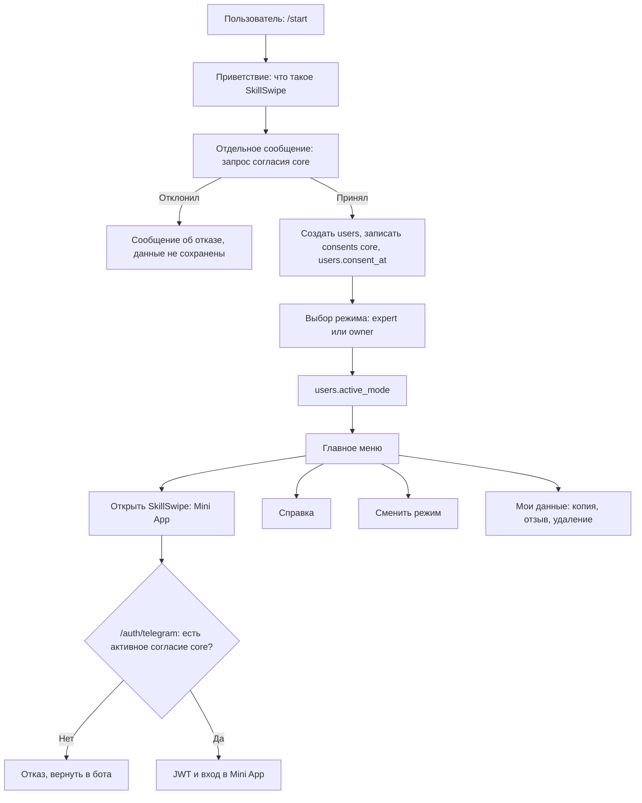

# Персональные данные в SkillSwipe: анализ и план проработки

| | |
| --- | --- |
| **Статус** | Черновик аналитика, требует юридической проверки |
| **Дата** | 23.11.2026 |
| **Связанные документы** | [`total.md`](total.md) (требования, ER, API), SSK-9 (Mini App) |
| **Владелец** | Аналитик |

> Документ не является юридической консультацией. Нормы 152-ФЗ изменялись в 2025 и 2026 годах, поэтому номера статей, сроки и перечни нужно сверить по официальному тексту (КонсультантПлюс, Гарант, pravo.gov.ru) до выхода к реальным пользователям. Места, требующие проверки, помечены **(проверить)**.

## 1. Цель и область

Определить, какие персональные данные (ПД) обрабатывает SkillSwipe, на каком основании, как их хранить в БД, как получать согласие и что менять в требованиях, API и модели данных. Отдельно описан целевой процесс онбординга в боте и тексты сообщений.

**Входит:** онбординг в боте (`/start`, согласие, режим, меню), согласия и их хранение, права пользователя (отзыв, экспорт, удаление), передача данных в LLM, безопасность хранения, документы (политика, согласие).

**Не входит:** интерфейс Mini App (SSK-9), юридическое оформление оператора как организации.

## 2. Допущения и решения, которые нужно принять

Ниже зафиксированы **предложения для утверждения по issue #23**, а не окончательные юридические решения. Дата подготовки: 23.11.2026. Ответственный за подготовку: аналитик (исполнитель #23); утверждение — команда проекта, вопросы права — юрист или наставник.

| № | Решение | Предлагаемое значение | Статус |
| --- | --- | --- | --- |
| D1 | Юрисдикция и аудитория | На первом этапе целевые пользователи — РФ; проектируем обработку с учётом 152-ФЗ. Выход на пользователей из ЕС — отдельное решение после проверки GDPR | Предложено, утвердить |
| D2 | Оператор ПД | Оператором может быть физлицо или ИП, как предварительно выбрала команда. Конкретные ФИО, статус, адрес/контакт для обращений пока не предоставлены | **Блокер:** команда и юрист должны определить лицо и подтвердить его готовность быть оператором |
| D3 | Хостинг | БД и объектное хранилище резюме должны находиться в РФ. Провайдера выбрать сравнением российских вариантов по региону хранения, условиям обработки, безопасности, доступности S3 и бюджету | Предложено; провайдер не выбран |
| D4 | LLM для ML-1 | ML-1 — необязательная функция с ручным выбором навыков как альтернативой; перед отправкой резюме — отдельное согласие и псевдонимизация. Не отправлять данные через OpenRouter «как есть» | Предложено; провайдер и страны получателей не выбраны, трансграничную передачу не включать до проверки юристом |
| D5 | Возраст | Доступ только с 18 лет; подтверждение включить в отдельный текст согласия | Предложено, утвердить |
| D6 | Сообщения при удалении аккаунта | Текст сообщений удалившегося пользователя заменить на «[удалено]», ссылку на его аккаунт обнулить; переписку собеседника сохранить | Предложено, утвердить |
| D7 | Срок хранения резюме | Файл и извлечённый текст удалить при подтверждении навыков или не позднее 30 календарных дней после загрузки — что наступит раньше | Предложение для минимизации; срок утвердить с командой и юристом |

Решение считается принятым только после подтверждения уполномоченным представителем команды и фиксации даты/ответственного. Неизвестные данные D2 и D3 нельзя заменять вымышленными значениями. Пока оператор не определён, согласие и политика не готовы к публикации.

## 3. Инвентаризация данных

| Данные | Таблица | Категория и риск | Цель | Срок хранения (предложение) |
| --- | --- | --- | --- | --- |
| Telegram ID, username, имя, язык | `users` | Идентификатор | Аккаунт, вход | Пока аккаунт активен |
| Согласия | `consents` (новая) | Доказательство законности обработки | Подтверждение согласия | Пока есть аккаунт, далее срок для журнала уточнить с юристом **(проверить)** |
| Профиль: о себе, опыт, часы в неделю, формат | `expert_profile` | Показывается другим пользователям | Подбор | Пока аккаунт активен |
| Резюме (файл и извлечённый текст; фактические имена полей сверить со схемой) | `resumes` | **Высокий:** телефон, email, места работы, часто возраст и фото | Извлечение навыков | Предложение D7: до подтверждения навыков или максимум 30 календарных дней после загрузки; утвердить |
| Навыки | `expert_skill`, `project_skill` | Низкий | Подбор | Пока аккаунт активен |
| Проекты | `project` | Данные пользователя, видны другим | Подбор | Пока аккаунт активен |
| Свайпы, мэтчи, оценки | `swipe`, `match`, `recommendation_score` | Профилирование поведения | Ранжирование, мэтчи | Пока аккаунт активен |
| Сообщения чата | `message` | Тайна переписки, ПД собеседника | Общение | Пока есть мэтч и аккаунт, решение D6 |
| Эмбеддинги | `embedding` | Производные от ПД, считаются ПД | Ранжирование | Каскадно с владельцем |
| Жалобы | `report` | ПД третьих лиц | Модерация | Ограниченный срок после разбора |
| События | `event_log` | Не должны содержать тексты ПД | Продуктовые метрики | Ограниченный срок |
| Вызовы LLM | `llm_call` | Только хэш входа и метрики | Лимиты, воспроизводимость | Ограниченный срок |
| Состояние ботов | `bot_start` | Служебные | Доставка сообщений | Пока аккаунт активен |
| Скрытие пользователей | `user_block` | Служебные | Приватность | Пока аккаунт активен |

**Не собираем:** телефон, email, паспортные данные, дату рождения, фото, геолокацию. Username опционален (US-22).

**Специальные категории** (здоровье, политические и религиозные взгляды и т. п., ст. 10 152-ФЗ) не собираются. Резюме может их содержать: нужно предупреждение при загрузке и фильтрация при разборе.

## 4. Правовая карта

### 4.1. 152-ФЗ «О персональных данных»

| Тема | Требование | Что делаем |
| --- | --- | --- |
| Согласие (ст. 9) | С 1 сентября 2025 согласие оформляется отдельно от других документов и информации, которые подтверждает человек ([156-ФЗ от 24.06.2025](https://www.garant.ru/news/1850806/)). Согласие должно быть конкретным, предметным, информированным, сознательным и однозначным ([Контур](https://kontur.ru/articles/1577)). Штрафы за нарушение порядка согласия доходят до 700 тыс. руб. ([Гарант](https://www.garant.ru/article/1862510/)) | Отдельное сообщение только про согласие, без склейки с правилами и политикой. Отдельные согласия на отдельные цели (раздел 8) |
| Форма согласия | Допускается любая форма, позволяющая подтвердить факт получения ([buh.ru](https://buh.ru/articles/novyy-poryadok-oformleniya-soglasiy-na-obrabotku-personalnykh-dannykh-s-1-sentyabrya-2025-goda.html)) | Кнопка в боте плюс журнал `consents`. Юрист подтверждает, какие реквизиты ч. 4 ст. 9 нужны для такой формы **(проверить)** |
| Политика (ст. 18.1) | Публичная политика обработки ПД | Страница вне бота, ссылка в боте, регистрация в BotFather |
| Специальные категории (ст. 10) | Обработка ограничена | Не собираем, предупреждаем в форме загрузки резюме |
| Распространение (ст. 10.1) | Для ПД, разрешённых для распространения неопределённому кругу, нужно отдельное согласие | Показ профиля в ленте может быть квалифицирован как распространение, поэтому отдельное согласие на публикацию профиля и показ в ленте только профессиональных полей **(проверить у юриста)** |
| Трансграничная передача (ст. 12) | До начала трансграничной передачи оператор направляет отдельное уведомление. Действующая редакция статьи 12 изменена 265-ФЗ от 26.07.2026; для государств вне перечня адекватной защиты передача не начинается до истечения предусмотренного срока рассмотрения уведомления | Для любого LLM-провайдера установить юридическое лицо-получателя и страны обработки, сверить актуальный перечень и получить сведения от получателя. Не передавать данные до заключения юриста и выполнения применимых требований статьи 12 ([актуальный текст статьи 12](https://www.consultant.ru/document/cons_doc_LAW_61801/e4ebbe1780de623c7cf32a59ca82a7bb523a25dd/)) |
| Локализация (ч. 5 ст. 18) | Первичная запись, хранение и накопление ПД граждан РФ на серверах в РФ ([Клерк](https://www.klerk.ru/user/2548465/716829/)) | БД и файловое хранилище в РФ |
| Уведомление об обработке (ст. 22) | Подают [все операторы](https://habr.com/ru/post/914414), включая ИП и самозанятых | Подать до выхода к реальным пользователям |
| Права субъекта (ст. 14, 21) | Ответ на запрос о данных в течение [10 рабочих дней](https://www.klerk.ru/blogs/fedresurs/679821). При отзыве согласия прекращение обработки и уничтожение данных (по моим данным, 30 дней, совпадает с NFR-06) | Эндпоинты отзыва, экспорта и удаления, регламент ответов на запросы **(проверить срок ст. 21)** |
| Утечки | Уведомление Роскомнадзора об инциденте в короткие сроки (по моим данным, 24 часа и 72 часа) | План реагирования на инциденты **(проверить сроки)** |

### 4.2. Правила Telegram Bot Platform

По [Bot Developer Terms](https://telegram.org/tos/bot-developers?setln=en):

- Нужна политика конфиденциальности, [доступная пользователям](https://telegram.org/tos/bot-developers?setln=es); её регистрируют в BotFather, у Mini App в настройках появится кнопка Privacy Policy.
- Данные, присланные пользователем, можно использовать при [информировании и индивидуальном, явном, активном и отзываемом согласии](https://telegram.org/tos/bot-developers?setln=ar).
- Запрещено собирать и хранить данные сверх необходимого.
- Минимум по безопасности: [шифрование данных at rest с хранением ключа отдельно, оповещение пользователей об утечках](https://telegram.org/tos/bot-developers?setln=nl).
- Данные удаляются по запросу пользователя.
- Нарушения ведут к отключению бота.

### 4.3. GDPR (если будут пользователи из ЕС)

- Правовое основание (ст. 6), условия согласия (ст. 7), информирование (ст. 13), права субъекта (ст. 15–22).
- Договор с обработчиком, в том числе с LLM-провайдером (ст. 28), передача в третьи страны (ст. 44 и далее).
- Privacy by design (ст. 25), реестр обработки (ст. 30), безопасность (ст. 32).
- Уведомление об утечке за 72 часа (ст. 33), оценка воздействия DPIA для профилирования (ст. 35).
- Возраст согласия зависит от страны (для Австрии 14 лет).

### 4.4. Вопросы для юриста

1. Бот-ретранслятор между пользователями (чат) может подпадать под правила о сервисах обмена мгновенными сообщениями (149-ФЗ). Подтвердить или исключить.
2. Дайджест (US-19): если в нём появится реклама, нужно отдельное согласие по 38-ФЗ.
3. Нужно ли оформлять показ профиля в ленте как согласие на распространение (ст. 10.1).
4. Какие реквизиты ч. 4 ст. 9 требуются при согласии кнопкой.
5. Срок и основание хранения журнала согласий и хэша `telegram_id` для блокировок после удаления аккаунта.

## 5. Целевой процесс онбординга



Что меняем относительно исходного видения:

1. **`users` создаётся только после согласия.** До этого состояние диалога хранится в FSM (память или Redis с TTL). Тогда фраза в сообщении об отказе «мы ничего не сохранили» остаётся верной.
2. **Одного `users.consent_at` недостаточно.** Нужен журнал согласий с версией документа (раздел 6.1). Поле `users.consent_at` остаётся как кэш основного согласия.
3. **Согласие в отдельном сообщении**, без других документов и без галочек по умолчанию (требование ст. 9).
4. **Consent gate на backend.** Проверка в боте недостаточна: `/auth/telegram` не выдаёт JWT без активного согласия `core`.
5. **Ссылка на политику** в боте, в меню и в BotFather. Режим (`active_mode`) не относится к специальным категориям.
6. **Дополнительные согласия запрашиваются в момент использования функции:** публикация профиля при сохранении профиля, ИИ при загрузке резюме, дайджест при его включении, username при включении US-22.
7. **Язык.** Тексты согласия и меню хранятся во внешних словарях (NFR-17) и версионируются.

## 6. Хранение в БД

### 6.1. Таблица согласий

```sql
CREATE TABLE consents (
    id                BIGSERIAL PRIMARY KEY,
    user_id           BIGINT       NOT NULL REFERENCES users(id) ON DELETE CASCADE,
    consent_type      VARCHAR(32)  NOT NULL,   -- core | llm_processing | profile_publication | digest | username_visibility
    document_version  VARCHAR(32)  NOT NULL,   -- версия текста согласия
    document_hash     CHAR(64)     NOT NULL,   -- SHA-256 текста, который видел пользователь
    language          VARCHAR(8)   NOT NULL,
    source            VARCHAR(16)  NOT NULL,   -- bot | miniapp
    granted_at        TIMESTAMPTZ  NOT NULL DEFAULT now(),
    revoked_at        TIMESTAMPTZ
);

-- Не более одного активного согласия каждого типа на пользователя
CREATE UNIQUE INDEX uq_consents_active
    ON consents (user_id, consent_type)
    WHERE revoked_at IS NULL;
```

Что делаем с журналом при удалении аккаунта (каскад или обезличивание) определяет юрист, см. вопрос 5 раздела 4.4. Файл миграции Liquibase оформляется как `migrations/changelogs/ssk-XX.xml` и подключается в `master.yaml`.

### 6.2. Правила хранения

1. **Минимизация.** Таблицы и поля только под перечисленные цели, без «на всякий случай».
2. **Резюме.** Файл лежит в приватном объектном хранилище в РФ, в БД только путь. Файл и извлечённый текст удаляются после подтверждения навыков или максимум через 30 календарных дней после загрузки (предложение D7, ожидает утверждения). Перед реализацией сверить реальные поля `resumes.extracted_text` и `resumes.extracted_data`.
3. **Шифрование.** Шифрование диска или СУБД и дополнительно шифрование полей `resume.parsed_text` и `message.text` на уровне приложения. Ключи хранятся вне БД, переменные окружения, секреты не в репозитории.
4. **Эмбеддинги.** У `Embedding.owner_id` нет внешнего ключа, поэтому каскад не сработает автоматически. Нужны явное удаление в сервисе удаления аккаунта и тест на него.
5. **Лента.** До мэтча показываем только профессиональные поля. Фамилия, username и контакты не показываются.
6. **Сообщения при удалении аккаунта.** Текст сообщений удалившегося пользователя заменяется на «[удалено]», ссылка на пользователя обнуляется (D6).
7. **Блокировки.** Чтобы заблокированный пользователь не вернулся после удаления, хранится посоленный хэш `telegram_id`; основание и срок согласовать с юристом.
8. **Логи.** В `event_log.payload`, stdout, Sentry и других логах нет текстов профилей, резюме и сообщений. В `llm_call` только `input_hash`, модель, токены, стоимость, статус.
9. **Бэкапы.** Срок ротации не превышает срок удаления данных (30 дней).
10. **Доступ.** Роли БД по принципу минимальных прав, на dev и в тестах только синтетика, на демонстрациях без реальных профилей.
11. **Удаление.** Срок по NFR-06 (30 дней). Ответ на запрос пользователя о его данных не позднее 10 рабочих дней.

### 6.3. Новые и изменяемые эндпоинты

| Метод | Путь | Описание |
| --- | --- | --- |
| POST | `/consents` | Записать согласие (тип, версия документа) |
| POST | `/consents/{type}/revoke` | Отозвать согласие. Для `core` равно запросу на удаление аккаунта |
| GET | `/users/me/consents` | Список согласий пользователя |
| GET | `/users/me/data-export` | Выгрузка данных пользователя |
| DELETE | `/users/me` | Уже есть. Доработать: явное удаление `embedding`, обезличивание `message` |
| POST | `/auth/telegram` | Доработать: отказ без активного согласия `core` |

Команды бота: `/privacy`, раздел меню «Мои данные».

## 7. LLM и трансграничная передача

### Предлагаемое решение D4 (ожидает утверждения)

1. ML-1 с резюме — необязательная функция; ручной выбор навыков остаётся доступным.
2. Перед первой передачей запрашивается отдельное согласие `llm_processing`.
3. Перед отправкой удаляются или маскируются телефоны, email, ссылки и username, ФИО, адреса, даты рождения; `original_filename` и метаданные файла не передаются. Псевдонимизация снижает риск, но сама по себе не доказывает анонимизацию.
4. Предпочтительный путь — российский провайдер при приемлемом качестве. Если команда выберет зарубежного провайдера, до включения функции юрист подтверждает получателей, страны и требования статьи 12; уведомление и прочие применимые действия выполняются до передачи.
5. В `llm_call` сохраняются только хэш входа, модель, токены, стоимость и статус. В логах нет текста запроса/ответа.

Провайдер, его юридическое лицо, страны обработки, договорные условия и качество на размеченной выборке ещё не установлены. До их подтверждения передача резюме в LLM выключена. Обновлённые требования статьи 12 включают изменения 265-ФЗ от 26.07.2026; перед запуском проверить актуальный перечень стран и получить юридическое заключение ([текст статьи 12](https://www.consultant.ru/document/cons_doc_LAW_61801/e4ebbe1780de623c7cf32a59ca82a7bb523a25dd/)).

Это меняет NFR-06: согласие на ИИ берётся при загрузке резюме, а не при `/start`.

## 8. Тексты бота (черновики)

Плейсхолдеры в `[скобках]` заполняются после решений из раздела 2. Лимит одного сообщения Telegram 4096 символов, полный текст согласия и политика публикуются на странице вне бота.

### 8.1. Ответ на /start

> 👋 Привет! Это **SkillSwipe**: сервис, где эксперты находят стартап-проекты, а основатели находят экспертов под нужные навыки.
> Как это работает: листайте карточки, свайпайте вправо, если интересно. Когда интерес взаимный, открывается чат.
> Чтобы продолжить, нужно ваше согласие на обработку персональных данных.
>
> `[Продолжить]`

### 8.2. Запрос согласия (отдельное сообщение)

> 📋 **Согласие на обработку персональных данных**
> **Оператор:** [наименование, контакт].
> **Что обрабатываем:** ваш Telegram ID, имя и username в Telegram, язык интерфейса; данные, которые вы укажете сами (о себе, опыт, навыки, доступность); ваши свайпы и мэтчи; сообщения в чате с участниками мэтча.
> **Зачем:** создать аккаунт, подбирать вам проекты или экспертов, оформлять мэтчи и переписку, присылать уведомления.
> **Что делаем:** собираем, храним, используем, удаляем.
> **Кто ещё получает данные:** [хостинг-провайдер, страна]. Резюме и тексты в ИИ-сервисы не передаём без вашего отдельного согласия.
> **Срок:** пока вы пользуетесь сервисом. После отзыва согласия или удаления аккаунта удалим данные в течение 30 дней.
> **Отзыв:** в любой момент: «Меню → Мои данные» или письмо на [email].
> Нажимая «Согласен(на)», вы подтверждаете, что вам не менее 18 лет, и даёте согласие на обработку данных, как описано выше.
>
> `[✅ Согласен(на)]` `[❌ Не согласен(на)]`
> `[📄 Полный текст согласия]` `[🔒 Политика конфиденциальности]`

### 8.3. После согласия

> Спасибо, согласие сохранено ✅ Его можно отозвать в любой момент: «Меню → Мои данные».
> Что вы ищете?
>
> `[🔎 Ищу проект]` `[🧑‍💻 Ищу экспертов]`

### 8.4. Отказ

> Понимаем. Без согласия мы не можем создать аккаунт и подбирать вам проекты или экспертов. Мы ничего о вас не сохранили. Если передумаете, отправьте /start.

### 8.5. Главное меню

> 🏠 **Главное меню.** Ваш режим: «Ищу проект».
>
> `[🚀 Открыть SkillSwipe]` (кнопка Mini App) `[🔄 Сменить режим]` `[ℹ️ Справка]` `[🔒 Мои данные]`

### 8.6. Справка

> **SkillSwipe** помогает находить проекты и экспертов по навыкам.
> • «Открыть SkillSwipe» открывает ленту карточек со свайпами.
> • «Сменить режим» переключает между «Ищу проект» и «Ищу экспертов».
> • «Мои данные» показывает, как получить копию данных, отозвать согласие или удалить аккаунт.
> Вопросы: [контакт поддержки].

### 8.7. Мои данные

> Здесь вы управляете своими данными:
>
> `[📥 Получить копию данных]` `[🚫 Отозвать согласие]` `[🗑 Удалить аккаунт]` `[🔒 Политика конфиденциальности]`

### 8.8. Подтверждение отзыва или удаления

> Отзыв согласия означает удаление аккаунта. Мы удалим профиль, навыки, свайпы и мэтчи в течение 30 дней. В чатах собеседников останется переписка без вашего имени. Продолжить?
>
> `[Да, удалить]` `[Отмена]`

### 8.9. Согласие на ИИ при загрузке резюме (необязательное)

> Чтобы автоматически определить ваши навыки, текст резюме будет передан ИИ-сервису [название, страны]. Перед отправкой мы скрываем телефон, email, ссылки и ФИО. Файл удалим через [N] дней.
> Это необязательно: навыки можно выбрать вручную.
>
> `[✅ Разрешить]` `[✍️ Выбрать вручную]`

### 8.10. Согласие на публикацию профиля (при сохранении профиля)

> Ваш профиль (о себе, опыт, навыки, доступность; **без** фамилии, username и контактов) будет виден другим пользователям SkillSwipe в ленте. Это можно отозвать в любой момент.
>
> `[✅ Опубликовать]` `[Не публиковать]`

### 8.11. Скелет полного текста согласия

1. Оператор и контакты.
2. Цели обработки.
3. Перечень персональных данных.
4. Действия и способы обработки.
5. Получатели и обработчики (хостинг; при согласии на ИИ также LLM-провайдер и страны).
6. Сроки обработки.
7. Порядок отзыва согласия.
8. Последствия отказа.
9. Подтверждение возраста 18+.
10. Версия документа и дата.

### 8.12. Скелет политики конфиденциальности

Оператор и контакты; цели и правовые основания; категории данных и источники; сроки хранения; получатели и трансграничная передача; меры защиты; права пользователя и порядок обращений; автоматизированная обработка (ранжирование и профилирование по свайпам, объяснение релевантности US-20); дайджест и уведомления; изменения политики; дата редакции.

## 9. Изменения в требованиях (предложение)

### 9.1. Новые user stories

| ID | История | Критерии приёмки | Приор-т |
| --- | --- | --- | --- |
| US-25 | Как пользователь, я хочу отозвать согласие и удалить аккаунт из раздела «Мои данные», чтобы контролировать свои данные | **Given** я в «Мои данные», **When** подтверждаю отзыв, **Then** согласие помечается отозванным, начинается удаление данных в срок по NFR-06 | M |
| US-26 | Как пользователь, я хочу получить копию своих данных, чтобы знать, что обо мне хранится | **Given** я в «Мои данные», **When** запрашиваю копию, **Then** получаю выгрузку профиля, навыков, свайпов, мэтчей и своих сообщений | S |

### 9.2. Новые и изменяемые функциональные требования

| ID | Требование | US | Приор-т |
| --- | --- | --- | --- |
| FR-29 | Журнал согласий: тип, версия документа, хэш текста, время выдачи и отзыва | US-01 | M |
| FR-30 | Аккаунт создаётся только после принятия согласия `core`; до этого данные в БД не сохраняются | US-01 | M |
| FR-31 | Consent gate: `/auth/telegram` и API не работают без активного согласия `core` | US-02 | M |
| FR-32 | Отзыв согласия и удаление аккаунта из раздела «Мои данные» | US-25 | M |
| FR-33 | Экспорт данных пользователя | US-26 | S |
| FR-34 | Отдельные согласия: `llm_processing` при загрузке резюме, `profile_publication` при сохранении профиля, `digest`, `username_visibility` | US-04, US-03, US-19, US-22 | M |
| FR-35 | Команда `/privacy` и раздел «Мои данные» в меню бота | US-25 | M |
| FR-01 (изм.) | Добавить: согласие запрашивается отдельным сообщением, до его принятия записи о пользователе не создаются | US-01 | M |
| FR-18 (изм.) | Добавить: явное удаление эмбеддингов, обезличивание сообщений по решению D6 | US-17 | S |

### 9.3. Нефункциональные требования

| ID | Требование | Метрика и порог | Проверка |
| --- | --- | --- | --- |
| NFR-06 (изм.) | Убрать формулировку про согласие на LLM при `/start`. Согласие на ИИ запрашивается при загрузке резюме. Удаление в течение 30 дней, ответ на запрос не позже 10 рабочих дней | Соответствие процессу из раздела 5 | Ревью, функциональный тест |
| NFR-21 | Хранение и обработка ПД на серверах в РФ | БД и файловое хранилище размещены в РФ | Ревью инфраструктуры |
| NFR-22 | Логи без ПД | Нет текстов профилей, резюме и сообщений в логах, `event_log`, Sentry | Выборочный просмотр, тест |
| NFR-23 | Сроки хранения | Резюме и `parsed_text` удаляются по правилу D7, бэкапы не дольше 30 дней | Тест фоновой задачи, ревью |
| NFR-24 | Шифрование | Диск или СУБД шифруются, поля `parsed_text` и `message.text` шифруются приложением, ключи хранятся отдельно | Ревью, чек-лист |

### 9.4. Исправление US-01

В критериях приёмки заменить «создаётся аккаунт по Telegram ID» на «после принятия согласия создаётся аккаунт и записывается согласие `core` с версией документа; при отказе записи не создаются».

## 10. План работ

| Этап | Что делаем | Кто | Спринт |
| --- | --- | --- | --- |
| 0. Решения | D1–D7, консультация с юристом или наставником | Аналитик, команда | 3 |
| 1. Реестр данных | Раздел 3 с целями, основаниями и сроками | Аналитик | 3 |
| 2. Документы | Политика, согласие, дополнительные согласия, тексты бота, регистрация политики в BotFather | Аналитик | 3 |
| 3. Требования | Раздел 9 внести в `total.md` | Аналитик | 3 |
| 4. Модель данных и API | `consents`, миграция Liquibase, эндпоинты раздела 6.3, каскад эмбеддингов, TTL резюме | Backend | 3–4 |
| 5. Онбординг в боте | Процесс из раздела 5 | Backend | 3–4 |
| 6. ML и LLM | Псевдонимизация, выбор провайдера, журнал `llm_call` без текстов | ML-1, ML-2, backend | 3–4 |
| 7. Безопасность | Шифрование, роли БД, очистка логов, бэкапы, план реагирования на инциденты | Backend | 4 |
| 8. Регуляторика | Уведомление РКН об обработке (ст. 22), при зарубежном LLM уведомление по ст. 12, проверка локализации | Аналитик, backend | до выхода к реальным пользователям |
| 9. Тесты и приёмка | Сценарии из раздела 11 | Аналитик, backend | 4 |

## 11. Критерии готовности и тест-кейсы

- [ ] До принятия согласия в БД нет записей о пользователе (проверка: отказ на шаге согласия).
- [ ] Без активного согласия `core` `/auth/telegram` отказывает.
- [ ] Согласие записывается с версией документа, хэшем и временем.
- [ ] Отзыв согласия и удаление аккаунта убирают данные из всех таблиц, включая `embedding`, и обезличивают `message`.
- [ ] Резюме и `parsed_text` удаляются по правилу D7.
- [ ] В логах, `event_log` и `llm_call` нет текстов ПД.
- [ ] В ленте до мэтча не показываются фамилия, username и контакты.
- [ ] Согласия `llm_processing`, `profile_publication`, `digest` запрашиваются в момент использования функции.
- [ ] Политика доступна по ссылке из бота и зарегистрирована в BotFather.
- [ ] Тексты согласия и меню локализованы и версионируются.
- [ ] Юридическая проверка текстов и схемы обработки выполнена.

## 12. Риски

| Риск | Мера |
| --- | --- |
| Передача текста резюме в зарубежный LLM | Раздел 7: опциональная функция, псевдонимизация или российский LLM |
| Склейка согласия с другими документами | Отдельное сообщение и отдельные согласия (ст. 9) |
| Показ профиля в ленте квалифицирован как распространение | Профессиональные поля до мэтча, отдельное согласие на публикацию |
| Срок хранения в бэкапах больше срока удаления | Ротация бэкапов не дольше 30 дней |
| Осиротевшие эмбеддинги при удалении | Явное удаление и тест |
| Правовые нормы меняются | Сверка по официальному тексту перед релизом, пересмотр раздела 4 |

## 13. Источники

- Закон от 24.06.2025 № 156-ФЗ, новая редакция ч. 1 ст. 9 152-ФЗ: [Гарант](https://www.garant.ru/news/1850806/), [Гарант: штрафы и порядок](https://www.garant.ru/article/1862510/), [Контур](https://kontur.ru/articles/1577)
- Форма согласия: [buh.ru](https://buh.ru/articles/novyy-poryadok-oformleniya-soglasiy-na-obrabotku-personalnykh-dannykh-s-1-sentyabrya-2025-goda.html)
- Трансграничная передача: [Клерк](https://www.klerk.ru/blogs/moedelo/567870), [pravo.ru](https://pravo.ru/opinion/266312/), [Состав: изменения 2026](https://www.sostav.ru/blogs/293571/113022)
- Локализация: [Клерк](https://www.klerk.ru/user/2548465/716829/)
- Уведомление об обработке: [Хабр](https://habr.com/ru/post/914414)
- Права субъекта: [Клерк](https://www.klerk.ru/blogs/fedresurs/679821)
- Telegram Bot Platform Developer Terms: <https://telegram.org/tos/bot-developers>
- Текст 152-ФЗ, ст. 12: [rulaws.ru](https://rulaws.ru/amp/laws/Federalnyy-zakon-ot-27.07.2006-N-152-FZ/Statya-12/)
